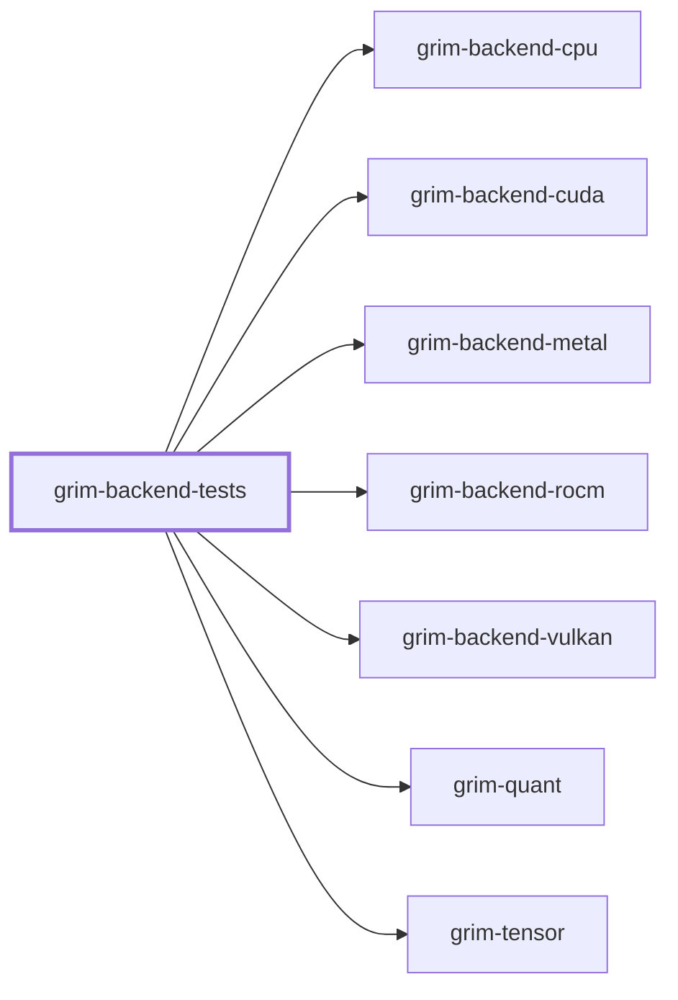

# grim-backend-tests

Cross-backend numerical parity test suite and Known-Answer Tests (KAT) validating execution consistency across CPU, ROCm, CUDA, Vulkan, and Metal backends in Grim.

[Back to project README](../../README.md)

## Dependencies

External dependencies: `rand`.

## Flamegraph

Not applicable - library crate (no binary).

## Source Layout

| Folder | Purpose |
|---|---|
| `src/` | Parity matrix test constants and shared test harness helpers |

## Key Responsibilities

- Multi-format numerical parity tests verifying identical results across accelerator backends and CPU reference math.
- Known-Answer Tests for quantized operations including Q8_0, Q4_K, Q5_K, Q6_K, and Iq4Nl across varying hidden dimensions.
- Cross-crate pipeline integration tests ensuring stable device dispatch and tensor lifetime management.
