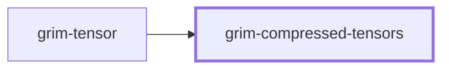

# grim-compressed-tensors

Unified container format (`.gcct`) and type tags for compressed weight tensors across multi-scheme quantization formats in Grim.

[Back to project README](../../README.md)

## Dependencies

External dependencies: none.

## Flamegraph

Not applicable - library crate (no binary).

## Source Layout

| Folder | Purpose |
|---|---|
| `src/` | GCCT container serialization, versioning, type-tag decoding, and reference W8A8 dequantization |

## Key Responsibilities

- Container format (`.gcct`) encoding type-tagged metadata and payload sections for compressed neural network tensors.
- Type definitions and serialization for W8A8MXFP8, WNA16, EmbeddingWNA16Int, CompressedTensors W8A8 Int8, and CompressedTensors W8A8 FP8 (OCP E4M3).
- Fast reference CPU dequantization and float conversion routines.
