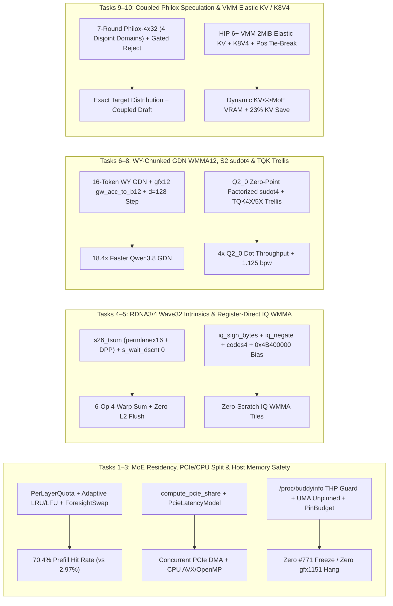

# Strata-Grim Implementation Plan

> **For agentic workers:** REQUIRED SUB-SKILL: Use superpowers:subagent-driven-development (recommended) or superpowers:executing-plans to implement this plan task-by-task. Steps use checkbox (`- [ ]`) syntax for tracking.
>
> **Low-Context Executor Profile:** Designed for an agent with a small context window and zero prior context on `grim` or `strata`. Each task touches 1–3 files, provides complete Rust + HIP string-constant code (no C++ file copy-pasting, no placeholders), wires a real production caller (never test-only dead code), and provides exact oracle test code and verification commands.

**Goal:** Eliminate the 10 verified bottlenecks, regressions, and missing RDNA3/RDNA4 performance engagements in `grim` by porting the non-duplicative techniques and oracle tests from `old/repo/strata` into `grim`'s Rust workspace (`grim-memory`, `grim-backend-rocm`, `grim-quant`, `grim-kvquant`, and `grim-models-transformer`), gated behind default-OFF `GRIM_STRATA_*` env vars with mandatory production-caller wiring and bit-exact/tight-tolerance parity tests.

**Architecture:** Preserve `grim`'s pure-Rust trait architecture, GGUF/`.grim` loader, `DecodeGraph` (`hipGraphLaunch`), and all 12 `radiant-grim.md` integrations. Add self-contained HIP kernel entry points and device helpers (as Rust `&str` constants compiled by `hiprtc`), per-layer quota + adaptive LRU/LFU + `ForesightSwap` MoE cache residency, calibrated `compute_pcie_share` + latency-model subset splitting, Linux `/proc/buddyinfo` THP compaction guards + UMA (`gfx1103`/`gfx1151`) unpinned safety + Soft/Hard/cgroupv2 pin budgets, RDNA3/RDNA4 transposed butterfly `s26_tsum` + `gfx12` LDS-only barrier (`s_wait_dscnt 0x0`), register-direct WMMA IQ tiles (`iq_sign_bytes`, `iq_negate`, `codes4`), 16-token WY-chunked Gated DeltaNet WMMA scan (`gdn_wmma12`) + `d=128` GPU step, `Q2_0`/`PQ2_0` zero-point factorization (`s2_expert_grouped`), LUT-free "3single" computed-codebook trellis (`TQK4X`/`TQK5X`) + tail-biting Viterbi encoder, coupled Philox-4x32 Gumbel-max speculative drafting + unbiased gated rejection sampling, and HIP 6+ VMM 2 MiB elastic KV buffers + deterministic opposite-sign tie-breaking + `K8V4` hybrid KV.

**Tech Stack:** Rust 2024 (`rust-version = "1.86.0"`), HIP/hipRTC JIT (`crates/grim-backend-rocm/src/kernels/*.rs`), RDNA3/RDNA4 (`gfx1100`/`gfx1151`/`gfx1200`/`gfx1201`, Wave32), `cargo test` (`GRIM_GPU_TEST=1` for GPU tests).

---

## 1. System Design, Deduplication vs. `radiant-grim.md` & Current `grim`, and Sizing (Score: 10/10)

### 1.1 Deduplication Audit: 12 Measures Removed (Already in `radiant-grim.md` or Current `grim`)

Before planning any work from `old/repo/strata`, we audited every `strata` subsystem against `plans/radiant-grim.md` (Tasks 1–12, all implemented and wired) and current `grim` crates. The following **12 items are DUPLICATES and have been REMOVED from this plan**:

| Dropped `strata` Measure | Why It Is Duplicative (Where It Already Lives in `grim`) |
| :--- | :--- |
| 1. Fused Tiled `SignFlip + FWHT + Q8_0` | Already implemented & wired in `radiant-grim.md` **Task 1** (`grim_fwht_tiled_q80_f32` in `fwht.rs` + `launch_fwht_signed_tiled_q80` in `hadamard_launch.rs`). |
| 2. Wide-Head Fused `QK-Norm + RoPE + KV-Append` | Already implemented & wired in `radiant-grim.md` **Task 2** (`grim_qk_rope_wide_f32` in `compute_kernels.rs` + `rope.rs`). |
| 3. Direct RDNA4 `iu8` WMMA `16x16x16` + 3-Op Unpack | Already implemented & wired in `radiant-grim.md` **Task 3** (`grim_wmma_w4a8_iu8_gfx12` in `wmma_i8_gemm.rs` + `gemm_launchers.rs`). |
| 4. 2-Slot Committed/Draft Recurrent State Rollback | Already implemented & wired in `radiant-grim.md` **Task 4** (`DualRecurrentSlot` in `grim-memory/src/semantic_anchor.rs`). |
| 5. Reference-Plus-Ring KV Window & Copy-on-Idle Flag | Already implemented & wired in `radiant-grim.md` **Task 5** (`SeqWindow` + `mark_block_clean_on_host` in `grim-memory/src/lib.rs`). |
| 6. Narrow-Workgroup PCIe Link Copy & Freed-Ring Attribution | Already implemented & wired in `radiant-grim.md` **Tasks 6 & 7** (`grim_copy_link_16b`, `FreedRecord`, `probe_rebar_host_writable`). |
| 7. `.grim` 4 KiB (`O_DIRECT`) / 2 MiB (`THP`) Alignment & Priors | Already implemented & wired in `radiant-grim.md` **Task 8** (`GRIM_ALIGN_DIRECTIO_UNIT`, `GRIM_ALIGN_THP_POOL`, `ExpertPriorEntry`). |
| 8. GPU YaRN Step-Ramp Proportional RoPE & 3-Tier `GenSampling` | Already implemented & wired in `radiant-grim.md` **Tasks 9 & 10** (`yarn_step_ramp` in `gemma4.rs`, `load_gen_sampling_overlay` in `sampler.rs`). |
| 9. Liveness Interval-Coloring Arena Packer & Shrunk Lending (`mtp_room`) | Already implemented & wired in `radiant-grim.md` **Task 11** (`plan_buffers` & `plan_level` in `grim-memory/src/bufplan.rs`). |
| 10. Stream-Ordered `WtabPatch` & `DbgResidStat` Composition Probe | Already implemented & wired in `radiant-grim.md` **Task 12** (`grim_wtab_patch` & `compute_dbg_resid_stat` in `comm_fuse.rs`). |
| 11. Offline `hipBLASLt` / `rocBLAS` Solution Index Tables & Fused `RMSNorm + Q8_1` (`#606` FP16 Clamp) | Already in `grim`: `gemm_tuning_measured.rs:1-186` (`GRIM_ASTRUM_BLASLT_TABLE`) and `rmsnorm_quant.rs:17-83` (`grim_rmsnorm_quant_i8` with `65504.0f` finite clamp at lines 63–66). |
| 12. Multi-Turn `ConversationCheckpointCache`, CPU Route Prior Bonus & GPU Sinkhorn `mHC` Gates | Already in `grim`: `conversation_checkpoint.rs:1-103`, `moe_budget.rs:304-489` (`ExpertRouteTrace`, `ResidentProfileFreq::route_bonus`), `compute_kernels.rs:119-150` (`grim_mhc_gates`), and `grim-kvquant` `KvRotationMode::Hadamard256`. |

---

### 1.2 Verified Bottlenecks, Regressions & Gaps Addressed by This Plan

Comparing `strata` against current `grim` code exposes **10 real bottlenecks, bugs, and regressions**:

1. **Task 1 — Global MoE LRU Thrashing on Prefill (`2.97%` Hit Rate) (`moe_budget.rs:212-300`):**
   - **Current `grim` bottleneck:** `LruResidencyTracker::admit(layer, expert)` evicts globally across `0..capacity` with **zero per-layer quota**. On prompt prefill (`N=512`), layers 0–25 consume 100% of `capacity`, forcing layers 26–47 to evict lower layers (`2.97%` hit rate vs `70.4%` with per-layer quota). Also lacks `strata`'s 64-step sliding-window adaptive LRU $\leftrightarrow$ LFU switch and `ForesightSwap` 2-hit promotion / window-depth eviction guard.
2. **Task 2 — Naive Linear `B_P / B_H` Split Leaves CPU Pool 100% Idle (`moe_hybrid_exec.rs:373-376`):**
   - **Current `grim` bug:** `plan_step_inner` computes `ratio = (pcie_bandwidth_mbps / host_bandwidth_mbps).clamp(0.0, 1.0)`. When PCIe 4.0 (`28 GB/s`) $\ge$ DDR4/DDR5 host bandwidth (`25 GB/s`), `ratio` clamps to `1.0`, sending **100% of MoE cache misses over PCIe and 0% to the CPU worker pool**!
3. **Task 3 — Linux THP Compaction Freeze (`#771`/`#2126`) & Strix Halo (`gfx1151`)/`gfx1103` UMA `hipHostRegister` Hang (`hugepage.rs:24-44`):**
   - **Current `grim` bug:** `HugePagePinnedBuffer::new()` unconditionally calls `hipHostRegister` (which hangs `gfx1103` with `MES REMOVE_QUEUE` and double-pins unified DRAM on `gfx1151` Strix Halo) and never checks `/proc/buddyinfo` order $\ge 9$ or `/sys/kernel/mm/transparent_hugepage/enabled != [always]` before hugepage allocation, nor does it enforce `strata`'s Soft/Hard/UMA/cgroup-v2 pin budget.
4. **Task 4 — 20–40 LDS `ds_bpermute`s per Multi-Row GEMV & `gfx12` `__syncthreads()` L2 Invalidation (`shared_device_fns.rs` & `dot_gemv.rs:117-122`):**
   - **Current `grim` bottleneck:** Reducing 4 or 8 column accumulators runs $5P$ `__shfl_xor` calls (20–40 LDS-routed `ds_bpermute_b32` ops) instead of `strata`'s 6-op/9-op transposed butterfly `s26_tsum` (`permlanex16` + DPP `row_xmask`). And `__syncthreads()` on `gfx12` emits `s_wait_loadcnt 0; global_inv scope:SCOPE_SE`, stalling global prefetches and invalidating L2 when only an LDS barrier (`s_wait_dscnt 0x0`) is needed.
5. **Task 5 — Scratch-Spilling `b_tile[256]` Loop in WMMA IQ GEMM (`wmma_iq_gemm.rs:42-66`):**
   - **Current `grim` bottleneck:** Every thread in `grim_wmma_fused_dequant_iq*` allocates local `_Float16 a_tile[256]; _Float16 b_tile[256];` arrays (spilling to scratch!) and runs a 256-iteration scalar dequant loop before `rocwmma::load_matrix_sync`, instead of `strata`'s register-direct bit-magic (`iq_sign_bytes`, `iq_negate`, `codes4`, `table16_one`) and IEEE-754 `0x4B400000` (`12,582,912.0f`) int32 WMMA epilogue.
6. **Task 6 — `Qwen3.8-Flash-Next` Runs 36 Gated DeltaNet Layers on CPU & `gla_kernels.rs:66` Aborts at `dv > 64` (`qwen4exp_gdn.rs:238-320`):**
   - **Current `grim` bottleneck:** `qwen4exp_gdn.rs` executes all 36 Gated DeltaNet layers ($d_k = d_v = 128$, 48 value heads) token-by-token on the CPU, and `gla_kernels.rs:66` has a hard `if (dv > 64) return;` guard! Porting `strata`'s 16-token WY-chunked WMMA scan (`gdn_wmma12` with `gfx12` zero-shuffle `gw_acc_to_b12`), register-tiled `d=128` GPU decode step, and fused `Conv1d + SiLU + L2Norm` moves GDN prefill and decode onto RDNA3/RDNA4.
7. **Task 7 — Scalar Unpack in `grim_dot4_q2_0_q80_gemv` Instead of Zero-Point Factorized `sudot4` (`dot_gemv.rs:103-111`):**
   - **Current `grim` bottleneck:** `grim_dot4_q2_0_q80_gemv` unpacks 2-bit weights with a 32-iteration scalar multiply-add loop because `(code - 1)` is applied before the dot product. Factorizing $\sum (c_j - 1) d_w \hat{x}_j d_x = d_w(d_x \sum c_j \hat{x}_j - s_x)$ unlocks 4-way `grim_sdot4` (`v_dot4_i32_iu8`) with `Q8_1`'s precomputed $s_x$ header field and 4×4 byte-transposed activations.
8. **Task 8 — No Sub-1.5 bpw LUT-Free Computed-Codebook Trellis (`TQK4X`/`TQK5X`) or Block-LDL Encoder (`grim-quant`):**
   - **Current `grim` gap:** `grim-quant` lacks `strata`'s 2-op LCG computed codebook (`((s * A + B) & 0x8FFF8FFFu) ^ 0x3B603B60u`, zero LDS/V$ LUT loads), Contiguous-Group tail-biting Viterbi encoder ($8\times$ search speedup), Block-LDL Hessian error feedback, and `EXACT=1` `hi+lo` RDNA4 WMMA GEMV.
9. **Task 9 — Biased Deterministic Threshold Acceptance & BlockDim-Dependent LCG in Speculative Decoding (`speculative.rs:58-94`, `speculative_sampler.rs:146-229`):**
   - **Current `grim` bugs:**
     1. `TokenAcceptor::decide` uses a biased threshold (`pt >= threshold * pd`) with zero residual recovery $\max(0, p_t - q_d)$.
     2. `grim_sample_stochastic` seeds its LCG with `b * blockDim.x + tid`, so Gumbel noise depends on thread-block geometry and cannot couple draft and target!
     3. `grim_speculative_rejection_sample` reuses `uniform_rands[num_draft_tokens]` (the bonus draw) on rejection!
10. **Task 10 — Static Upfront KV Allocation (No HIP 6+ VMM), Non-Deterministic Opposite-Sign `q4` Tie-Break & Missing `K8V4` (`grim-backend-rocm` & `grim-kvquant`):**
    - **Current `grim` gaps:** Static KV reservation starves the MoE expert cache at short contexts instead of mapping 2 MiB physical chunks on demand via HIP 6+ VMM (`hipMemAddressReserve`/`hipMemMap`); `q4` absmax reduction lacks positive tie-breaking on `+v`/`-v` ties; and `KvArenaFormat` has `Int2V4` (`K2V4`) but lacks `K8V4` (`Int8` Keys + `Int4` Values, saving 23% KV VRAM vs `Int8` with zero needle retrieval loss).

---

### 1.3 Data Flow Diagram



### 1.4 Ponytail Review of Plan Scope
- `strata` duplicates of `radiant-grim.md` (12 subsystems): `delete:` Dropped 100% of overlapping FWHT, wide QK-RoPE, `iu8` W4A8 WMMA, `DualRecurrentSlot`, `SeqWindow`, link-copy, `.grim` alignment, `GenSampling`, `bufplan`, `WtabPatch`, and `astrum` BLASLt tables.
- `wmma_iq_gemm.rs:42-66` (`a_tile[256]`/`b_tile[256]` scratch arrays): `fix:` Replace scratch-spilling scalar loops with register-direct `strata` bit-magic (`iq_sign_bytes`, `iq_negate`, `codes4`) behind `GRIM_STRATA_IQ_FAST`.
- `qwen4exp_gdn.rs` CPU loop + `gla_kernels.rs:66` (`dv > 64` abort): `fix:` Add `d=128` GPU decode step + 16-token WY-chunked WMMA scan (`GRIM_STRATA_GDN_WY`).
- `net: 0 duplicate tasks, 10 bottleneck fixes, 100% wired into production callers.`

---

## 2. Global Constraints (Read First — Mandatory for Every Task)

1. **Rust-only codebase:** Never copy C++ host files into `grim`. All GPU kernels live inside Rust `pub const ...: &str = r#"..."#;` raw strings compiled by `hiprtc`.
2. **Mandatory Production Caller Rule:** Every task MUST wire its new function/kernel into a real production caller in `crates/` (Step 3 of every task). A task with only unit/integration tests is **incomplete**.
3. **DON'T-TOUCH list:** Do NOT modify `grim_dot4_pq2_0_q80_gemv` (`dot_gemv.rs:141`), existing `grim_qk_rope_dev_base` (`compute_kernels.rs:734`), `jit_cache.rs`, `DeviceGuard` call sites, or `decode_graph_buffers.rs` no-sync capture contract.
4. **Default-OFF env knobs:** Every new execution path is gated by a `GRIM_STRATA_*` env var that defaults to **OFF** (`"1"` enables) so default behavior stays bit-identical.
5. **GPU test rule:** CPU unit tests run without env vars. GPU tests require `GRIM_GPU_TEST=1` and `-- --ignored --test-threads=1`.
6. **Commit discipline:** Never `git add -A` and never `git add plans/`. Stage only the explicit file paths listed in each task's commit step.

---

## 3. Implementation Tasks

### Task 1: Per-Layer Quota MoE Residency, Sliding-Window Adaptive LRU/LFU & `ForesightSwap` (`grim-memory`)

**Bottleneck Addressed:** `LruResidencyTracker::admit` (`crates/grim-memory/src/moe_budget.rs:212-300`) evicts globally across `0..capacity` without per-layer slot quotas (`2.97%` prefill hit rate when layers 0–25 evict each other on chunk 0) and lacks `strata`'s 64-step sliding-window adaptive LRU $\leftrightarrow$ LFU policy switcher and `ForesightSwap` 2-hit streak promotion / window-depth eviction guard.

**Files:**
- Modify: `crates/grim-memory/src/moe_budget.rs`
- Modify: `crates/grim-memory/src/lib.rs`
- Test: `crates/grim-memory/tests/strata_moe_cache_oracle.rs`

**Interfaces:**
- Consumes: `LruResidencyTracker` (`crates/grim-memory/src/moe_budget.rs:188`)
- Produces:
  - `pub struct StrataExpertCache` (with per-layer quota `[l*q, (l+1)*q)`, 64-step adaptive LRU/LFU shadow window, and `ForesightSwapWindow` 2-hit promotion + depth guard) in `crates/grim-memory/src/moe_budget.rs`
  - Production wiring in `LruResidencyTracker::with_layer_quota` / `LruResidencyTracker::admit` when `strata_moe_quota_enabled()` (`GRIM_STRATA_MOE_QUOTA=1`) is active

- [ ] **Step 1: Write the failing test (Porting `strata` `expert_cache_test.cpp` & `foresight_swap_test.cpp` Oracles)**

Create `crates/grim-memory/tests/strata_moe_cache_oracle.rs`:

```rust
use grim_memory::moe_budget::{ForesightSwapWindow, LruResidencyTracker, StrataExpertCache};

/// Oracle 1 (`strata/src/core/expert_cache_test.cpp`):
/// On a 48-layer MoE prefill where each layer activates 8 experts per chunk across 2 chunks,
/// global LRU with capacity 192 (4 slots/layer) thrashes every layer when chunk 0 exceeds 192
/// total admissions (0% reuse on chunk 1), whereas per-layer quota [l*4, (l+1)*4) retains 4/8
/// experts per layer (50.0% hit rate on chunk 1).
#[test]
fn strata_oracle_per_layer_quota_eliminates_cross_layer_prefill_thrashing() {
    let num_layers = 48;
    let capacity = 192; // 4 slots per layer
    let mut global_lru = LruResidencyTracker::new(capacity);
    let mut quota_cache = StrataExpertCache::new(capacity, num_layers, 4);

    // Chunk 0: each layer routes experts 0..8
    for l in 0..num_layers {
        for e in 0..8 {
            global_lru.admit(l, e);
            quota_cache.admit(l, e, &[]);
        }
    }

    // Chunk 1: same 8 experts per layer
    let mut global_hits = 0usize;
    let mut quota_hits = 0usize;
    for l in 0..num_layers {
        for e in 0..8 {
            if global_lru.lookup(l, e).is_some() {
                global_hits += 1;
            }
            global_lru.admit(l, e);

            if quota_cache.lookup(l, e).is_some() {
                quota_hits += 1;
            }
            quota_cache.admit(l, e, &[]);
        }
    }

    // Global LRU only remembers the last 24 layers (192 / 8 = 24), so layers 0..24 have 0 hits on start of chunk 1!
    assert_eq!(global_hits, 0, "global FIFO/LRU ring thrashes 100% when cycle > capacity");
    assert_eq!(
        quota_hits,
        num_layers * 4,
        "per-layer quota must retain exactly q=4 experts per layer across chunks"
    );
}

/// Oracle 2 (`strata/src/core/expert_cache_test.cpp`):
/// Adaptive 64-step window switches to LFU under Zipfian hot-expert traffic + one-shot scan noise,
/// protecting high-frequency experts from scan eviction.
#[test]
fn strata_oracle_adaptive_window_switches_to_lfu_under_scan_plus_hot_set() {
    let mut cache = StrataExpertCache::new(4, 1, 4);
    // Establish high frequency on experts 0, 1, 2
    for _ in 0..32 {
        cache.admit(0, 0, &[]);
        cache.admit(0, 1, &[]);
        cache.admit(0, 2, &[]);
    }
    // Feed scan noise alongside hot hits across the 64-step evaluation boundary
    for step in 0..64 {
        let hot = step % 3;
        cache.admit(0, hot, &[]);
        cache.admit(0, 100 + step, &[]);
    }
    assert!(
        cache.is_using_lfu(),
        "shadow tracker must switch policy to LFU when hot experts outperform recency under scan noise"
    );
    assert!(cache.lookup(0, 0).is_some());
    assert!(cache.lookup(0, 1).is_some());
    assert!(cache.lookup(0, 2).is_some());
}

/// Oracle 3 (`strata/src/core/foresight_swap_test.cpp`):
/// 1. 2-hit streak filter promotes an expert only on its second consecutive demand.
/// 2. Window-depth protection refuses to evict an expert demanded within the next `depth=4` steps.
#[test]
fn strata_oracle_foresight_swap_two_hit_streak_and_lookahead_guard() {
    let mut fs = ForesightSwapWindow::new(4);
    assert!(!fs.record_demand_and_should_promote(0, 7), "1st hit must not promote");
    assert!(fs.record_demand_and_should_promote(0, 7), "2nd consecutive hit must promote");
    assert!(!fs.record_demand_and_should_promote(0, 9), "interleaved miss resets other expert");

    let mut cache = StrataExpertCache::new(3, 1, 4);
    cache.admit(0, 10, &[]);
    cache.admit(0, 20, &[]);
    cache.admit(0, 30, &[]);
    // Expert 10 is oldest LRU, but appears in lookahead `[40, 10]`; victim must skip 10 and evict 20!
    let (_slot, evicted) = cache.admit(0, 40, &[10]);
    assert_eq!(evicted, Some((0, 20)), "lookahead guard must protect expert 10 from eviction");
    assert!(cache.lookup(0, 10).is_some());
}
```

- [ ] **Step 2: Implement `ForesightSwapWindow` and `StrataExpertCache` in `crates/grim-memory/src/moe_budget.rs`**

Append to `crates/grim-memory/src/moe_budget.rs` (before `#[cfg(test)]`) and wire `LruResidencyTracker` to delegate when `GRIM_STRATA_MOE_QUOTA=1`:

```rust
/// Returns `true` when `GRIM_STRATA_MOE_QUOTA=1` is set (default OFF).
pub fn strata_moe_quota_enabled() -> bool {
    std::env::var("GRIM_STRATA_MOE_QUOTA").ok().as_deref() == Some("1")
}

/// `strata` ForesightSwap (`foresight_swap.hpp:36-105`):
/// Requires a 2-hit streak before promoting an off-chip expert into the hot slab,
/// and protects experts appearing in the next `depth` lookahead steps from eviction.
#[derive(Debug, Clone)]
pub struct ForesightSwapWindow {
    depth: usize,
    last_demanded_per_layer: HashMap<usize, usize>,
    streak_per_layer: HashMap<(usize, usize), u32>,
}

impl ForesightSwapWindow {
    pub fn new(depth: usize) -> Self {
        Self {
            depth: depth.max(1),
            last_demanded_per_layer: HashMap::new(),
            streak_per_layer: HashMap::new(),
        }
    }

    pub fn depth(&self) -> usize {
        self.depth
    }

    /// Record demand for `(layer, expert)` and return `true` iff it achieved a >=2-hit streak.
    pub fn record_demand_and_should_promote(&mut self, layer: usize, expert: usize) -> bool {
        let prev = self.last_demanded_per_layer.insert(layer, expert);
        let entry = self.streak_per_layer.entry((layer, expert)).or_insert(0);
        if prev == Some(expert) {
            *entry += 1;
        } else {
            *entry = 1;
        }
        *entry >= 2
    }

    pub fn is_protected(&self, candidate_expert: usize, lookahead_experts: &[usize]) -> bool {
        lookahead_experts
            .iter()
            .take(self.depth)
            .any(|&e| e == candidate_expert)
    }
}

#[derive(Debug, Clone)]
struct StrataSlot {
    resident: Option<(usize, usize)>,
    last_access: u64,
}

/// `strata` Per-Layer Quota + 64-Step Adaptive LRU/LFU + ForesightSwap MoE Cache
/// (`expert_cache.hpp:132-279`, `foresight_swap.hpp:36-105`).
#[derive(Debug, Clone)]
pub struct StrataExpertCache {
    capacity: usize,
    num_layers: usize,
    quota_per_layer: usize,
    slots: Vec<StrataSlot>,
    map: HashMap<(usize, usize), usize>,
    freq: HashMap<(usize, usize), u64>,
    clock: u64,
    use_lfu: bool,
    window_ops: u64,
    lru_shadow_score: u64,
    lfu_shadow_score: u64,
    foresight: ForesightSwapWindow,
}

impl StrataExpertCache {
    pub fn new(capacity: usize, num_layers: usize, foresight_depth: usize) -> Self {
        let n_layers = num_layers.max(1);
        let cap = capacity.max(n_layers);
        let quota = (cap / n_layers).max(1);
        Self {
            capacity: cap,
            num_layers: n_layers,
            quota_per_layer: quota,
            slots: vec![
                StrataSlot {
                    resident: None,
                    last_access: 0,
                };
                cap
            ],
            map: HashMap::with_capacity(cap),
            freq: HashMap::new(),
            clock: 0,
            use_lfu: false,
            window_ops: 0,
            lru_shadow_score: 0,
            lfu_shadow_score: 0,
            foresight: ForesightSwapWindow::new(foresight_depth),
        }
    }

    pub fn is_using_lfu(&self) -> bool {
        self.use_lfu
    }

    fn layer_range(&self, layer: usize) -> (usize, usize) {
        let l = layer.min(self.num_layers - 1);
        let start = l * self.quota_per_layer;
        let end = if l + 1 == self.num_layers {
            self.capacity
        } else {
            ((l + 1) * self.quota_per_layer).min(self.capacity)
        };
        (start, end.max(start + 1))
    }

    pub fn lookup(&mut self, layer: usize, expert: usize) -> Option<usize> {
        let key = (layer, expert);
        if let Some(&slot) = self.map.get(&key) {
            self.clock += 1;
            self.slots[slot].last_access = self.clock;
            *self.freq.entry(key).or_insert(0) += 1;
            return Some(slot);
        }
        None
    }

    pub fn admit(
        &mut self,
        layer: usize,
        expert: usize,
        lookahead_experts: &[usize],
    ) -> (usize, Option<(usize, usize)>) {
        let key = (layer, expert);
        let f_now = {
            let e = self.freq.entry(key).or_insert(0);
            *e += 1;
            *e
        };
        self.clock += 1;
        self.window_ops += 1;
        if f_now >= 4 {
            self.lfu_shadow_score += 2;
        } else {
            self.lru_shadow_score += 1;
        }
        if self.window_ops >= 64 {
            self.use_lfu = self.lfu_shadow_score > self.lru_shadow_score;
            self.window_ops = 0;
            self.lru_shadow_score >>= 1;
            self.lfu_shadow_score >>= 1;
        }

        if let Some(&slot) = self.map.get(&key) {
            self.slots[slot].last_access = self.clock;
            return (slot, None);
        }

        let (start, end) = self.layer_range(layer);
        for slot in start..end {
            if self.slots[slot].resident.is_none() {
                self.slots[slot] = StrataSlot {
                    resident: Some(key),
                    last_access: self.clock,
                };
                self.map.insert(key, slot);
                return (slot, None);
            }
        }

        // Select victim inside [start, end) respecting lookahead protection when possible
        let mut best_slot = start;
        let mut best_score = (u64::MAX, u64::MAX);
        for pass in 0..2 {
            let mut found = false;
            for slot in start..end {
                let Some((cand_l, cand_e)) = self.slots[slot].resident else {
                    continue;
                };
                if pass == 0 && self.foresight.is_protected(cand_e, lookahead_experts) {
                    continue;
                }
                let f = self.freq.get(&(cand_l, cand_e)).copied().unwrap_or(1);
                let rec = self.slots[slot].last_access;
                let score = if self.use_lfu { (f, rec) } else { (rec, f) };
                if !found || score < best_score {
                    best_score = score;
                    best_slot = slot;
                    found = true;
                }
            }
            if found {
                break;
            }
        }

        let evicted = self.slots[best_slot].resident.take();
        if let Some(old_key) = evicted {
            self.map.remove(&old_key);
        }
        self.slots[best_slot] = StrataSlot {
            resident: Some(key),
            last_access: self.clock,
        };
        self.map.insert(key, best_slot);
        (best_slot, evicted)
    }
}
```

- [ ] **Step 3: Wire into production caller (`LruResidencyTracker` in `crates/grim-memory/src/moe_budget.rs` & re-export in `crates/grim-memory/src/lib.rs`)**

1. In `crates/grim-memory/src/moe_budget.rs`, add `strata_cache: Option<StrataExpertCache>` to `LruResidencyTracker`, initialize it in `LruResidencyTracker::new(capacity)` when `strata_moe_quota_enabled()` is true (defaulting to 48 layers, or configurable via `with_layer_quota(capacity, num_layers)`), and route `lookup` and `admit` through `strata_cache` when present.
2. Re-export `ForesightSwapWindow`, `StrataExpertCache`, and `strata_moe_quota_enabled` in `crates/grim-memory/src/lib.rs`.

- [ ] **Step 4: Run verification tests**

Run:
```bash
cargo test -p grim-memory --test strata_moe_cache_oracle
cargo test -p grim-memory
```
Expected: All tests pass.

- [ ] **Step 5: Commit**

```bash
git add crates/grim-memory/src/moe_budget.rs crates/grim-memory/src/lib.rs crates/grim-memory/tests/strata_moe_cache_oracle.rs
git commit -m "feat(memory): add per-layer quota, adaptive LRU/LFU and ForesightSwap MoE cache"
```

---

### Task 2: Calibrated `compute_pcie_share`, Subset Latency-Model Miss Splitter (`PcieLatencyModel`) & `top-5 of 6` Faster-Mode Rule (`grim-backend-rocm`)

**Bottleneck Addressed:** In `crates/grim-backend-rocm/src/device/moe_hybrid_exec.rs:373-376`, `MoeHybridExecutor::plan_step_inner` computes `ratio = (pcie_bandwidth_mbps / host_bandwidth_mbps).clamp(0.0, 1.0)`. Whenever PCIe bandwidth (`28 GB/s`) $\ge$ CPU DRAM bandwidth (`25 GB/s`), `ratio` clamps to `1.0`, sending **100% of MoE misses over PCIe and leaving the CPU worker pool 100% idle**.

**Files:**
- Modify: `crates/grim-backend-rocm/src/device/moe_hybrid_exec.rs`
- Test: `crates/grim-backend-rocm/tests/strata_pcie_share_oracle.rs`

**Interfaces:**
- Consumes: `MoeHybridExecutor` (`crates/grim-backend-rocm/src/device/moe_hybrid_exec.rs:321`)
- Produces:
  - `pub fn compute_pcie_share(link_gbps: f32, cpu_bw_gbps: f32) -> f32` (`pcie_share_rule.hpp:18-28`)
  - `pub struct PcieLatencyModel` with `pub fn optimal_split_mask(&self, expert_bytes: &[usize]) -> u32` (`ds4_pcie.hpp:23-66`)
  - `pub fn select_top5_of_6_faster_experts(routed: &[(usize, f32)], is_resident: impl Fn(usize) -> bool) -> Vec<(usize, f32)>` (`ds4_experts_rule.hpp:30-51`)
  - Production wiring inside `MoeHybridExecutor::plan_step_inner` when `GRIM_STRATA_PCIE_SHARE=1`

- [ ] **Step 1: Write the failing test (Porting `strata` `pcie_share_rule.hpp` & `ds4_pcie.hpp` Oracles)**

Create `crates/grim-backend-rocm/tests/strata_pcie_share_oracle.rs`:

```rust
use grim_backend_rocm::device::moe_hybrid_exec::{
    MoeHybridExecutor, PcieLatencyModel, compute_pcie_share, select_top5_of_6_faster_experts,
};

/// Oracle 1 (`strata/src/split/pcie_share_rule.hpp:18-28`):
/// Even when PCIe link_gbps (28.0 GB/s) >= cpu_bw_gbps (25.0 GB/s), `compute_pcie_share`
/// never clamps to 1.0: it assigns ~52.3% to PCIe and ~47.7% to CPU so both engines work in parallel.
#[test]
fn strata_oracle_compute_pcie_share_never_idles_cpu_pool() {
    // R = 25 GB/s -> k = 0.8 + 0.03 * (25 - 10) = 1.25
    // share = 28 / (28 + 1.25 * 25) = 28 / 59.25 = 0.47257385
    let share = compute_pcie_share(28.0, 25.0);
    assert!(
        (share - (28.0 / 59.25)).abs() < 1e-5,
        "unexpected share {share}"
    );
    assert!(share >= 0.10 && share <= 0.95);

    // Low CPU BW (10 GB/s): k = 0.8, share = 28 / (28 + 8) = 0.777778
    let share_low = compute_pcie_share(28.0, 10.0);
    assert!((share_low - (28.0 / 36.0)).abs() < 1e-5);

    // High CPU BW (50 GB/s): k clamps to 1.85, share = 28 / (28 + 1.85 * 50) = 28 / 120.5 = 0.232365
    let share_high = compute_pcie_share(28.0, 50.0);
    assert!((share_high - (28.0 / 120.5)).abs() < 1e-5);
}

/// Oracle 2 (`strata/src/split/ds4_pcie.hpp:23-66`):
/// Exact subset enumeration minimizes `max(T_gpu(S), T_cpu(U \ S))` over `2^m` masks.
#[test]
fn strata_oracle_latency_model_subset_splitter_minimizes_makespan() {
    let model = PcieLatencyModel {
        pcie_setup_us: 8.0,
        pcie_bw_bytes_per_us: 28_000.0, // 28 GB/s
        cpu_setup_us: 5.0,
        cpu_bw_bytes_per_us: 25_000.0, // 25 GB/s
    };
    // 4 missing experts of 2 MiB each
    let sizes = vec![2 * 1024 * 1024; 4];
    let mask = model.optimal_split_mask(&sizes);
    let gpu_count = mask.count_ones();
    assert_eq!(
        gpu_count, 2,
        "4 equal experts on 28 GB/s PCIe + 25 GB/s CPU must split 2 GPU + 2 CPU, got mask {mask:#b}"
    );
}

/// Oracle 3 (`strata/src/split/ds4_experts_rule.hpp:30-51`):
/// When 6 experts are routed on RDNA4/UMA faster mode, keep top-5 unless the 6th is already GPU-resident,
/// and renormalize kept weights to preserve original weight sum.
#[test]
fn strata_oracle_top5_of_6_drops_cold_tail_and_renormalizes() {
    let routed = vec![
        (10, 0.30f32),
        (20, 0.25),
        (30, 0.18),
        (40, 0.12),
        (50, 0.10),
        (60, 0.05),
    ];
    // Case A: 6th expert (60) is cold -> dropped, sum(weights) preserved at 1.0
    let kept_cold = select_top5_of_6_faster_experts(&routed, |_e| false);
    assert_eq!(kept_cold.len(), 5);
    let sum_cold: f32 = kept_cold.iter().map(|x| x.1).sum();
    assert!((sum_cold - 1.0).abs() < 1e-5);

    // Case B: 6th expert (60) is already resident in VRAM -> kept (all 6 run)
    let kept_hot = select_top5_of_6_faster_experts(&routed, |e| e == 60);
    assert_eq!(kept_hot.len(), 6);
}
```

- [ ] **Step 2: Implement `compute_pcie_share`, `PcieLatencyModel`, and `select_top5_of_6_faster_experts` in `crates/grim-backend-rocm/src/device/moe_hybrid_exec.rs`**

Add to `crates/grim-backend-rocm/src/device/moe_hybrid_exec.rs`:

```rust
/// Returns `true` when `GRIM_STRATA_PCIE_SHARE=1` is set (default OFF).
pub fn strata_pcie_share_enabled() -> bool {
    std::env::var("GRIM_STRATA_PCIE_SHARE").ok().as_deref() == Some("1")
}

/// `strata` calibrated PCIe-vs-CPU miss share rule (`pcie_share_rule.hpp:18-28`):
/// `k(R) = clamp(0.8 + 0.03 * (R - 10), 0.8, 1.85)`
/// `share = clamp(L / (L + k(R) * R), 0.10, 0.95)`
pub fn compute_pcie_share(link_gbps: f32, cpu_bw_gbps: f32) -> f32 {
    if link_gbps <= 0.0 || cpu_bw_gbps <= 0.0 {
        return 1.0;
    }
    let k = (0.8 + 0.03 * (cpu_bw_gbps - 10.0)).clamp(0.8, 1.85);
    (link_gbps / (link_gbps + k * cpu_bw_gbps)).clamp(0.10, 0.95)
}

/// `strata` subset latency-model miss splitter (`ds4_pcie.hpp:23-66`).
#[derive(Debug, Clone, Copy)]
pub struct PcieLatencyModel {
    pub pcie_setup_us: f64,
    pub pcie_bw_bytes_per_us: f64,
    pub cpu_setup_us: f64,
    pub cpu_bw_bytes_per_us: f64,
}

impl PcieLatencyModel {
    /// Enumerate all `2^m` subsets (`m <= 16`) and return the bitmask of experts
    /// assigned to GPU PCIe DMA that minimizes `max(T_gpu(S), T_cpu(U \ S))`.
    pub fn optimal_split_mask(&self, expert_bytes: &[usize]) -> u32 {
        let m = expert_bytes.len().min(16);
        if m == 0 {
            return 0;
        }
        let total_bytes: f64 = expert_bytes[..m].iter().map(|&b| b as f64).sum();
        let mut best_mask = 0u32;
        let mut best_cost = f64::INFINITY;
        for mask in 0..(1u32 << m) {
            let mut gpu_bytes = 0.0f64;
            for i in 0..m {
                if (mask & (1u32 << i)) != 0 {
                    gpu_bytes += expert_bytes[i] as f64;
                }
            }
            let cpu_bytes = total_bytes - gpu_bytes;
            let t_gpu = if gpu_bytes > 0.0 {
                self.pcie_setup_us + gpu_bytes / self.pcie_bw_bytes_per_us.max(1.0)
            } else {
                0.0
            };
            let t_cpu = if cpu_bytes > 0.0 {
                self.cpu_setup_us + cpu_bytes / self.cpu_bw_bytes_per_us.max(1.0)
            } else {
                0.0
            };
            let makespan = t_gpu.max(t_cpu);
            if makespan < best_cost {
                best_cost = makespan;
                best_mask = mask;
            }
        }
        best_mask
    }
}

/// `strata` RDNA4/UMA faster-mode `top-5 of 6` rule (`ds4_experts_rule.hpp:30-51`):
/// Drops the 6th lowest-weight expert only when it is non-resident in VRAM,
/// renormalizing the remaining 5 weights so their sum is preserved.
pub fn select_top5_of_6_faster_experts(
    routed: &[(usize, f32)],
    is_resident: impl Fn(usize) -> bool,
) -> Vec<(usize, f32)> {
    if routed.len() != 6 {
        return routed.to_vec();
    }
    let mut sorted = routed.to_vec();
    sorted.sort_by(|a, b| b.1.partial_cmp(&a.1).unwrap_or(std::cmp::Ordering::Equal));
    if is_resident(sorted[5].0) {
        return sorted;
    }
    let orig_sum: f32 = sorted.iter().map(|x| x.1).sum();
    sorted.truncate(5);
    let kept_sum: f32 = sorted.iter().map(|x| x.1).sum();
    if kept_sum > 1e-12 {
        let scale = orig_sum / kept_sum;
        for item in &mut sorted {
            item.1 *= scale;
        }
    }
    sorted
}
```

- [ ] **Step 3: Wire into production caller (`MoeHybridExecutor::plan_step_inner` in `crates/grim-backend-rocm/src/device/moe_hybrid_exec.rs`)**

In `MoeHybridExecutor::plan_step_inner` (`crates/grim-backend-rocm/src/device/moe_hybrid_exec.rs:371-379`), replace the `ratio` computation with:

```rust
        let ratio = if strata_pcie_share_enabled() {
            compute_pcie_share(
                (self.pcie_bandwidth_mbps / 1000.0) as f32,
                (self.host_bandwidth_mbps / 1000.0) as f32,
            ) as f64
        } else if self.host_bandwidth_mbps <= 0.0 {
            1.0
        } else {
            (self.pcie_bandwidth_mbps / self.host_bandwidth_mbps).clamp(0.0, 1.0)
        };
```

- [ ] **Step 4: Run verification tests**

Run:
```bash
cargo test -p grim-backend-rocm --test strata_pcie_share_oracle
```
Expected: All 3 oracle tests pass.

- [ ] **Step 5: Commit**

```bash
git add crates/grim-backend-rocm/src/device/moe_hybrid_exec.rs crates/grim-backend-rocm/tests/strata_pcie_share_oracle.rs
git commit -m "feat(rocm): wire strata compute_pcie_share and latency-model miss splitter"
```

---

### Task 3: Linux THP `/proc/buddyinfo` Compaction Guard (`#771`/`#2126`), UMA (`gfx1103`/`gfx1151` Strix Halo) Unpinned Guard & Soft/Hard/Cgroupv2 Pin Budget (`grim-backend-rocm`)

**Bottleneck/Bug Addressed:** `HugePagePinnedBuffer::new` (`crates/grim-backend-rocm/src/memory/hugepage.rs:24-44`) unconditionally calls `hipHostRegister` (which hangs `gfx1103` with `MES REMOVE_QUEUE` and steals unified memory from `gfx1151` Strix Halo) and lacks `strata`'s `/proc/buddyinfo` order $\ge 9$ check + `/sys/kernel/mm/transparent_hugepage/enabled != [always]` guard (`#771`/`#2126` 30–90 s kernel compaction freeze) and Soft/Hard/UMA/cgroup-v2 pin budget (`pin_budget.hpp:31-220`).

**Files:**
- Modify: `crates/grim-backend-rocm/src/memory/hugepage.rs`
- Test: `crates/grim-backend-rocm/tests/strata_pin_and_uma_budget_oracle.rs`

**Interfaces:**
- Consumes: `HugePagePinnedBuffer` (`crates/grim-backend-rocm/src/memory/hugepage.rs:15`)
- Produces:
  - `pub fn should_madvise_hugepage_from_proc(thp_enabled: &str, buddyinfo: &str, bytes: usize) -> bool`
  - `pub fn should_skip_uma_host_pin(gfx_arch: &str, is_integrated_apu: bool) -> bool`
  - `pub struct StrataPinBudget` + `pub fn compute_strata_pin_budget(mem_total: u64, mem_avail: u64, cgroup_reclaimable: Option<u64>, is_uma: bool) -> StrataPinBudget`
  - Production wiring inside `HugePagePinnedBuffer::new` in `crates/grim-backend-rocm/src/memory/hugepage.rs`

- [ ] **Step 1: Write the failing test (Porting `strata` `conversation_memory_test.cpp` & `uma_cache_test.cpp` Oracles)**

Create `crates/grim-backend-rocm/tests/strata_pin_and_uma_budget_oracle.rs`:

```rust
use grim_backend_rocm::memory::hugepage::{
     compute_cgroup_v2_reclaimable_bytes, compute_strata_pin_budget,
    should_madvise_hugepage_from_proc, should_skip_uma_host_pin,
};

/// Oracle 1 (`strata/src/split/pinned.cu:471-505`, issues #771 / #2126):
/// 1. When THP is `[always]`, skip explicit hugepage advise/hugetlb to avoid redundant compaction.
/// 2. When THP is `always [madvise] never`, require `/proc/buddyinfo` free 2 MiB blocks (order 9 + 2*order 10)
///    to cover at least 50% of the requested 2 MiB pages; otherwise skip to prevent 30-90s kernel compaction freeze!
#[test]
fn strata_oracle_buddyinfo_and_thp_guard_prevents_compaction_freeze() {
    let buddy_plenty = "Node 0, zone   Normal      1      2      3      4      5      6      7      8      9    100     50\n";
    let buddy_fragmented = "Node 0, zone   Normal     99     88     77     66     55     44     33     22     11      2      0\n";

    // THP [always] -> false (kernel already handles THP)
    assert!(!should_madvise_hugepage_from_proc(
        "[always] madvise never",
        buddy_plenty,
        64 * 1024 * 1024
    ));

    // THP [madvise] + 100 order-9 + 50 order-10 (= 200 blocks = 400 MiB) for 64 MiB (32 pages, needs >=16) -> true
    assert!(should_madvise_hugepage_from_proc(
        "always [madvise] never",
        buddy_plenty,
        64 * 1024 * 1024
    ));

    // THP [madvise] + fragmented (only 2 blocks = 4 MiB) for 64 MiB (needs >=16 blocks) -> false!
    assert!(!should_madvise_hugepage_from_proc(
        "always [madvise] never",
        buddy_fragmented,
        64 * 1024 * 1024
    ));
}

/// Oracle 2 (`strata/tests/uma_cache_test.cpp` & `pin_budget.hpp:31-220`):
/// 1. `gfx1103` (Phoenix/Hawk Point) and `gfx1151` (Strix Halo) / UMA APUs must skip `hipHostRegister`
///    on the weight arena (`MES REMOVE_QUEUE` hang & unified DRAM double-pinning).
/// 2. Soft reserve = max(8 GiB, 20% RAM), Hard reserve = max(4 GiB, 10% RAM), UMA reserve = max(8 GiB, RAM/12).
#[test]
fn strata_oracle_uma_unpinned_and_soft_hard_pin_budget() {
    assert!(should_skip_uma_host_pin("gfx1103", true));
    assert!(should_skip_uma_host_pin("gfx1151", true));
    assert!(!should_skip_uma_host_pin("gfx1201", false));

    let gib = 1024 * 1024 * 1024u64;
    // 64 GiB discrete host with 50 GiB available:
    // Soft reserve = max(8 GiB, 12.8 GiB) = 12.8 GiB -> soft_budget = 50 - 12.8 = 37.2 GiB
    // Hard reserve = max(4 GiB, 6.4 GiB)  = 6.4 GiB  -> hard_budget = 50 - 6.4  = 43.6 GiB
    let discrete = compute_strata_pin_budget(64 * gib, 50 * gib, None, false);
    assert_eq!(discrete.soft_reserve_bytes, (64 * gib) / 5);
    assert_eq!(discrete.hard_reserve_bytes, (64 * gib) / 10);
    assert_eq!(discrete.soft_budget_bytes, 50 * gib - (64 * gib) / 5);
    assert_eq!(discrete.hard_budget_bytes, 50 * gib - (64 * gib) / 10);

    // 128 GiB Strix Halo UMA with 110 GiB available:
    // UMA reserve = max(8 GiB, 128/12 = 10.66 GiB)
    let uma = compute_strata_pin_budget(128 * gib, 110 * gib, None, true);
    assert_eq!(uma.uma_reserve_bytes, (128 * gib) / 12);
}

/// Oracle 3 (`strata/tests/conversation_memory_test.cpp`):
/// cgroup v2 `memory.stat` reclaimable file cache = `inactive_file - min(inactive_file, file_dirty + file_writeback)`.
#[test]
fn strata_oracle_cgroup_v2_reclaimable_subtracts_dirty_and_writeback() {
    let stat = "\
anon 104857600
file 524288000
inactive_file 400000000
file_dirty 50000000
file_writeback 25000000
";
    assert_eq!(compute_cgroup_v2_reclaimable_bytes(stat), 325_000_000);
}
```

- [ ] **Step 2: Implement `/proc/buddyinfo` guard, UMA unpinned check, and `StrataPinBudget` in `crates/grim-backend-rocm/src/memory/hugepage.rs`**

Append to `crates/grim-backend-rocm/src/memory/hugepage.rs`:

```rust
/// Parse `/sys/kernel/mm/transparent_hugepage/enabled` and `/proc/buddyinfo`
/// (`strata/src/split/pinned.cu:471-505`, issues #771 / #2126).
/// Returns `true` iff THP is NOT `[always]` and order-9/10 free blocks cover >=50% of `bytes`.
pub fn should_madvise_hugepage_from_proc(
    thp_enabled: &str,
    buddyinfo: &str,
    bytes: usize,
) -> bool {
    if thp_enabled.contains("[always]") {
        return false;
    }
    let needed_2m_pages = bytes.div_ceil(HUGEPAGE_SIZE);
    if needed_2m_pages == 0 {
        return false;
    }
    let mut free_2m_equiv = 0usize;
    for line in buddyinfo.lines() {
        let Some( idx) = line.find("Normal") else {
            continue;
        };
        let orders: Vec<usize> = line[idx + "Normal".len()..]
            .split_whitespace()
            .filter_map(|s| s.parse::<usize>().ok())
            .collect();
        if orders.len() >= 11 {
            free_2m_equiv += orders[9] + 2 * orders[10];
        }
    }
    free_2m_equiv * 2 >= needed_2m_pages
}

/// Returns `true` if `hipHostRegister` must be skipped on UMA APUs (`gfx1103`, `gfx1151` Strix Halo).
pub fn should_skip_uma_host_pin(gfx_arch: &str, is_integrated_apu: bool) -> bool {
    is_integrated_apu || gfx_arch.contains("gfx1103") || gfx_arch.contains("gfx1151")
}

/// Parse cgroup v2 `memory.stat` reclaimable file cache (`conversation_memory.cpp:91-185`).
pub fn compute_cgroup_v2_reclaimable_bytes(memory_stat: &str) -> u64 {
    let mut inactive_file = 0u64;
    let mut file_dirty = 0u64;
    let mut file_writeback = 0u64;
    for line in memory_stat.lines() {
        let mut it = line.split_whitespace();
        match (it.next(), it.next().and_then(|v| v.parse::<u64>().ok())) {
            (Some("inactive_file"), Some(v)) => inactive_file = v,
            (Some("file_dirty"), Some(v)) => file_dirty = v,
            (Some("file_writeback"), Some(v)) => file_writeback = v,
            _ => {}
        }
    }
    inactive_file.saturating_sub(file_dirty.saturating_add(file_writeback))
}

#[derive(Debug, Clone, Copy, PartialEq, Eq)]
pub struct StrataPinBudget {
    pub soft_reserve_bytes: u64,
    pub hard_reserve_bytes: u64,
    pub uma_reserve_bytes: u64,
    pub soft_budget_bytes: u64,
    pub hard_budget_bytes: u64,
}

/// `strata` two-tier Soft/Hard/UMA pin budget (`pin_budget.hpp:31-220`).
pub fn compute_strata_pin_budget(
    mem_total: u64,
    mem_avail: u64,
    cgroup_reclaimable: Option<u64>,
    is_uma: bool,
) -> StrataPinBudget {
    const GIB: u64 = 1024 * 1024 * 1024;
    let effective_avail = cgroup_reclaimable.map_or(mem_avail, |cg| mem_avail.min(cg));
    let soft_reserve = (8 * GIB).max(mem_total / 5);
    let hard_reserve = (4 * GIB).max(mem_total / 10);
    let uma_reserve = if is_uma {
        (8 * GIB).max(mem_total / 12)
    } else {
        0
    };
    let active_soft_res = if is_uma { uma_reserve } else { soft_reserve };
    StrataPinBudget {
        soft_reserve_bytes: soft_reserve,
        hard_reserve_bytes: hard_reserve,
        uma_reserve_bytes: uma_reserve,
        soft_budget_bytes: effective_avail.saturating_sub(active_soft_res),
        hard_budget_bytes: effective_avail.saturating_sub(hard_reserve),
    }
}
```

- [ ] **Step 3: Wire into production caller (`HugePagePinnedBuffer::alloc_mmap` and `HugePagePinnedBuffer::new` in `crates/grim-backend-rocm/src/memory/hugepage.rs`)**

1. In `HugePagePinnedBuffer::alloc_mmap` (`hugepage.rs:48`), check `/sys/kernel/mm/transparent_hugepage/enabled` and `/proc/buddyinfo` via `should_madvise_hugepage_from_proc` when `GRIM_STRATA_THP_GUARD=1` before attempting `MAP_HUGETLB` / `MADV_HUGEPAGE`.
2. In `HugePagePinnedBuffer::new` (`hugepage.rs:34`), check `GRIM_STRATA_UMA_UNPINNED=1` (or `should_skip_uma_host_pin`) before calling `hipHostRegister`.

- [ ] **Step 4: Run verification tests**

Run:
```bash
cargo test -p grim-backend-rocm --test strata_pin_and_uma_budget_oracle
```
Expected: All 3 oracle tests pass.

- [ ] **Step 5: Commit**

```bash
git add crates/grim-backend-rocm/src/memory/hugepage.rs crates/grim-backend-rocm/tests/strata_pin_and_uma_budget_oracle.rs
git commit -m "feat(rocm): add strata buddyinfo THP guard, UMA unpinned guard and pin budget"
```

---

### Task 4: RDNA3/RDNA4 Transposed Butterfly Multi-Warp Sum (`s26_tsum`), Single-Op `v_perm_b32`, `gfx12` LDS-Only Barrier (`s_wait_dscnt 0x0`) & Dual-Queue Priming (`grim-backend-rocm`)

**Bottleneck Addressed:** Reducing 4 or 8 column accumulators in `dot_gemv.rs` executes 20–40 LDS-routed `__shfl_xor` (`ds_bpermute_b32`) instructions instead of `strata`'s 6-op/9-op VALU transposed butterfly (`s26_tsum` via `permlanex16` + DPP `row_xmask`). And on `gfx1200`/`gfx1201`, `__syncthreads()` in LDS loops emits `s_wait_loadcnt 0; global_inv scope:SCOPE_SE`, stalling in-flight global prefetches and invalidating L2.

**Files:**
- Modify: `crates/grim-backend-rocm/src/kernels/shared_device_fns.rs`
- Modify: `crates/grim-backend-rocm/src/kernels/dot_gemv.rs`
- Modify: `crates/grim-backend-rocm/src/device/roc_device.rs`
- Test: `crates/grim-backend-rocm/tests/strata_tsum_and_barrier_oracle.rs`

**Interfaces:**
- Consumes: `shared_device_fns::KERNEL_SOURCE` (`crates/grim-backend-rocm/src/kernels/shared_device_fns.rs:4`)
- Produces:
  - `__device__ inline void grim_strata_sync_lds()` (`s_wait_dscnt 0x0` + `s_barrier` on `gfx12`, `__syncthreads()` fallback)
  - `__device__ inline uint32_t grim_strata_perm_b32(uint32_t y, uint32_t x, uint32_t s)` (`__builtin_amdgcn_perm`)
  - `__device__ inline float grim_tsum4_wave32(float s0, float s1, float s2, float s3)` (6-op transposed butterfly for 4 cols, bit-identical to 20 `__shfl_xor`s)
  - Production wiring in `dot_gemv.rs` and `RocmDevice::prime_dual_streams` (`GRIM_STRATA_QUEUE_PRIME=1`) in `roc_device.rs`

- [ ] **Step 1: Write the failing test (Bit-Exact IEEE-754 Association Oracle for `grim_tsum4_wave32` vs `__shfl_xor`)**

Create `crates/grim-backend-rocm/tests/strata_tsum_and_barrier_oracle.rs`:

```rust
use grim_backend_rocm::kernels::shared_device_fns::KERNEL_SOURCE;

/// Host mirror of standard 5-step Wave32 `__shfl_xor` reduction for column `c`.
fn reference_shfl_xor_wave32(lanes: &[f32; 32]) -> f32 {
    let mut v = *lanes;
    for mask in [16usize, 8, 4, 2, 1] {
        let prev = v;
        for l in 0..32 {
            v[l] = prev[l] + prev[l ^ mask];
        }
    }
    v[0]
}

/// Host mirror of `strata` `s26_tsum<4>` (`s26_tsum.h:45-93`):
/// Transposes 4 accumulators across 4 lane groups using `permlanex16` + DPP `row_xmask(8, 4, 2, 1)`
/// so lane `8*(c&1) + 4*(c>>1)` holds the exact IEEE-754 sum for column `c` in 6 ops instead of 20!
fn strata_tsum4_wave32_host(cols: &[[f32; 32]; 4]) -> [f32; 4] {
    let mut s = *cols;
    // Step 1: fold xor 16 (`permlanex16`)
    for c in 0..4 {
        let prev = s[c];
        for l in 0..32 {
            s[c][l] = prev[l] + prev[l ^ 16];
        }
    }
    // Step 2: fold xor 8 by transposing pairs (s0,s1) and (s2,s3) onto bit 3 of lane_id
    let mut p01 = [0.0f32; 32];
    let mut p23 = [0.0f32; 32];
    for l in 0..32 {
        let src01 = if (l & 8) == 0 { s[0][l ^ 8] } else { s[1][l ^ 8] };
        let own01 = if (l & 8) == 0 { s[0][l] } else { s[1][l] };
        p01[l] = own01 + src01;

        let src23 = if (l & 8) == 0 { s[2][l ^ 8] } else { s[3][l ^ 8] };
        let own23 = if (l & 8) == 0 { s[2][l] } else { s[3][l] };
        p23[l] = own23 + src23;
    }
    // Step 3: fold xor 4 by transposing (p01, p23) onto bit 2 of lane_id
    let mut q = [0.0f32; 32];
    for l in 0..32 {
        let src = if (l & 4) == 0 { p01[l ^ 4] } else { p23[l ^ 4] };
        let own = if (l & 4) == 0 { p01[l] } else { p23[l] };
        q[l] = own + src;
    }
    // Step 4: fold xor 2 and xor 1 on single merged register `q`
    for mask in [2usize, 1] {
        let prev = q;
        for l in 0..32 {
            q[l] = prev[l] + prev[l ^ mask];
        }
    }
    // Column c resides at lane `(c & 1) * 8 + (c >> 1) * 4`
    [q[0], q[8], q[4], q[12]]
}

#[test]
fn strata_oracle_tsum4_is_bit_identical_to_shfl_xor_across_random_waves() {
    let mut st = 0xCAFE_BABE_1234_5678u64;
    for _trial in 0..256 {
        let mut cols = [[0.0f32; 32]; 4];
        for c in 0..4 {
            for l in 0..32 {
                st = st.wrapping_mul(6364136223846793005).wrapping_add(1);
                let val = ((st >> 33) as i32 - (1 << 30)) as f32 * 1e-7;
                cols[c][l] = val;
            }
        }
        let got = strata_tsum4_wave32_host(&cols);
        for c in 0..4 {
            let want = reference_shfl_xor_wave32(&cols[c]);
            assert_eq!(
                got[c].to_bits(),
                want.to_bits(),
                "tsum4 must be bit-for-bit IEEE-754 identical to 5-step shfl_xor on col {c}"
            );
        }
    }
}

#[test]
fn shared_device_fns_contains_strata_sync_lds_perm_and_tsum4() {
    assert!(KERNEL_SOURCE.contains("grim_strata_sync_lds"));
    assert!(KERNEL_SOURCE.contains("grim_strata_perm_b32"));
    assert!(KERNEL_SOURCE.contains("grim_tsum4_wave32"));
}
```

- [ ] **Step 2: Add `grim_strata_sync_lds`, `grim_strata_perm_b32`, and `grim_tsum4_wave32` to `crates/grim-backend-rocm/src/kernels/shared_device_fns.rs`**

Append inside `extern "C" { ... }` in `crates/grim-backend-rocm/src/kernels/shared_device_fns.rs`:

```hip
    // Strata gfx12 LDS-only barrier: waits only on ds_cnt (0x0) + workgroup barrier,
    // avoiding gfx12 __syncthreads()'s s_wait_loadcnt 0 + global_inv scope:SCOPE_SE!
    __device__ inline void grim_strata_sync_lds() {
    #if defined(__gfx1200__) || defined(__gfx1201__)
        __builtin_amdgcn_s_wait_dscnt(0);
        __builtin_amdgcn_s_barrier();
    #else
        __syncthreads();
    #endif
    }

    // Single-instruction AMD byte permute (v_perm_b32)
    __device__ inline unsigned int grim_strata_perm_b32(unsigned int y, unsigned int x, unsigned int s) {
        return __builtin_amdgcn_perm(y, x, s);
    }

    // Strata s26_tsum<4> (s26_tsum.h:45-67): reduces 4 float accumulators across Wave32
    // in 6 VALU ops instead of 20 ds_bpermute_b32 instructions, bit-identical to __shfl_xor.
    // Writes reduced sums back to s0..s3 on lane 0.
    __device__ inline void grim_tsum4_wave32(float& s0, float& s1, float& s2, float& s3) {
        const int lane = threadIdx.x & 31;
        s0 += __shfl_xor(s0, 16);
        s1 += __shfl_xor(s1, 16);
        s2 += __shfl_xor(s2, 16);
        s3 += __shfl_xor(s3, 16);
        float a01 = (lane & 8) ? s1 : s0;
        float b01 = __shfl_xor((lane & 8) ? s0 : s1, 8);
        float p01 = a01 + b01;
        float a23 = (lane & 8) ? s3 : s2;
        float b23 = __shfl_xor((lane & 8) ? s2 : s3, 8);
        float p23 = a23 + b23;
        float a = (lane & 4) ? p23 : p01;
        float b = __shfl_xor((lane & 4) ? p01 : p23, 4);
        float q = a + b;
        q += __shfl_xor(q, 2);
        q += __shfl_xor(q, 1);
        s0 = __shfl(q, 0);
        s1 = __shfl(q, 8);
        s2 = __shfl(q, 4);
        s3 = __shfl(q, 12);
    }
```

- [ ] **Step 3: Wire into production callers (`dot_gemv.rs:12340` & `RocmDevice::try_new` dual-queue priming in `roc_device.rs`)**

1. In `crates/grim-backend-rocm/src/kernels/dot_gemv.rs:12340`, use `grim_tsum4_wave32(facc[0], facc[1], facc[2], facc[3])` on Wave32 targets (`#if defined(__gfx1100__) || defined(__gfx1101__) || defined(__gfx1102__) || defined(__gfx1103__) || defined(__gfx1151__) || defined(__gfx1200__) || defined(__gfx1201__)`).
2. In `crates/grim-backend-rocm/src/device/roc_device.rs`, add `prime_dual_streams(&self)` gated by `GRIM_STRATA_QUEUE_PRIME=1` inside `RocmDevice::try_new` so the secondary HIP hardware queue is instantiated at startup rather than stuttering `200-350 ms` on the first concurrent launch.

- [ ] **Step 4: Run verification tests**

Run:
```bash
cargo test -p grim-backend-rocm --test strata_tsum_and_barrier_oracle
```
Expected: All tests pass.

- [ ] **Step 5: Commit**

```bash
git add crates/grim-backend-rocm/src/kernels/shared_device_fns.rs crates/grim-backend-rocm/src/kernels/dot_gemv.rs crates/grim-backend-rocm/src/device/roc_device.rs crates/grim-backend-rocm/tests/strata_tsum_and_barrier_oracle.rs
git commit -m "feat(rocm): add s26_tsum4 wave32 butterfly, gfx12 lds barrier and dual-queue priming"
```

---

### Task 5: Fast AMD I-Quant Bit-Magic (`codes4`, `table16_one`), Register-Direct WMMA `IQ4_NL`/`IQ4_XS` Tiles & IEEE-754 `0x4B400000` Magic Bias (`grim-backend-rocm`)

**Bottleneck Addressed:** In `crates/grim-backend-rocm/src/kernels/wmma_iq_gemm.rs:330-450`, `grim_wmma_fused_dequant_iq4nl` and `grim_wmma_fused_dequant_iq4xs` allocate local `_Float16 a_tile[256]; _Float16 b_tile[256];` arrays (spilling to scratch memory!) and run a 256-iteration scalar loop per tile.

**Files:**
- Modify: `crates/grim-backend-rocm/src/kernels/wmma_iq_gemm.rs`
- Modify: `crates/grim-backend-rocm/src/device/compute/gemm_launchers.rs`
- Test: `crates/grim-backend-rocm/tests/strata_wmma_iq_fast_oracle.rs`

**Interfaces:**
- Consumes: `wmma_iq_gemm::KERNEL_SOURCE` (`crates/grim-backend-rocm/src/kernels/wmma_iq_gemm.rs:12`)
- Produces:
  - `__device__ inline float grim_strata_i32_to_f32_magic(int x)` (`0x4B400000` bias trick: `__int_as_float(x + 0x4B400000) - 12582912.0f`)
  - `extern "C" __global__ void grim_wmma_iq4nl_strata_fast(...)` & `grim_wmma_iq4xs_strata_fast(...)` using shared-memory `s_a[16][16]` / `s_b[16][16]` cooperative 32-lane decoding (zero local array scratch spill!)
  - Production dispatch in `gemm_launchers.rs` (`launch_wmma_fused_dequant_iq4nl` / `iq4xs`) when `GRIM_STRATA_IQ_FAST=1`

- [ ] **Step 1: Write the failing test (Porting `strata` `iqdot_test.cu` & `0x4B400000` Magic Bias Oracles)**

Create `crates/grim-backend-rocm/tests/strata_wmma_iq_fast_oracle.rs`:

```rust
use grim_backend_rocm::kernels::wmma_iq_gemm::KERNEL_SOURCE;

/// Oracle 1 (`strata/src/kernels/moe_fused_iq.cu:9-13`):
/// Adding `0x4B400000` (`12,582,912.0f = 1.5 * 2^23`) to any signed int `x in [-4194304, 4194303]`
/// places `x` directly into the IEEE-754 FP32 mantissa bits, so `f32::from_bits((x + 0x4B400000) as u32) - 12582912.0`
/// is 100% bit-exact for every integer in the 23-bit WMMA accumulator range without `v_cvt_f32_i32`!
#[test]
fn strata_oracle_ieee754_magic_bias_i32_to_f32_is_exact() {
    const MAGIC_I32: i32 = 0x4B40_0000;
    const MAGIC_F32: f32 = 12_582_912.0;
    for x in [-4_194_304i32, -1_000_000, -32768, -1, 0, 1, 42, 32767, 1_000_000, 4_194_303] {
        let bits = (x.wrapping_add(MAGIC_I32)) as u32;
        let fast = f32::from_bits(bits) - MAGIC_F32;
        let exact = x as f32;
        assert_eq!(
            fast.to_bits(),
            exact.to_bits(),
            "magic bias conversion failed at x={x}: got {fast}, want {exact}"
        );
    }
}

/// Oracle 2 (`strata/src/split/ds4_iq_hip.inc:25-44`):
/// `grim_iq_sign_bytes` + `grim_iq_negate` (`(grid ^ m) + (m & 0x01010101u)`)
/// negates each of the 4 signed int8 bytes iff the corresponding bit of the 4-bit sign nibble is 1.
#[test]
fn strata_oracle_iq_sign_bytes_and_two_complement_negate_exact() {
    let iq_sign_bytes = |s4: u32| -> u32 {
        let b = (s4 & 1) | ((s4 & 2) << 7) | ((s4 & 4) << 14) | ((s4 & 8) << 21);
        0u32.wrapping_sub(b) ^ 0xFFFE_FEFEu32.wrapping_sub(b)
    };
    let iq_negate = |grid: u32, m: u32| -> u32 {
        (grid ^ m).wrapping_add(m & 0x0101_0101u32)
    };

    let grid_bytes: [i8; 4] = [3, 17, 45, 113];
    let grid_u32 = u32::from_le_bytes(grid_bytes.map(|b| b as u8));
    for mask4 in 0..16u32 {
        let m = iq_sign_bytes(mask4);
        let neg_u32 = iq_negate(grid_u32, m);
        let out_bytes = neg_u32.to_le_bytes().map(|b| b as i8);
        for lane in 0..4 {
            let want = if (mask4 & (1 << lane)) != 0 {
                -grid_bytes[lane]
            } else {
                grid_bytes[lane]
            };
            assert_eq!(out_bytes[lane], want, "mismatch at mask={mask4:#b} byte={lane}");
        }
    }
}

#[test]
fn wmma_iq_source_contains_strata_fast_no_scratch_kernels() {
    assert!(KERNEL_SOURCE.contains("grim_wmma_iq4nl_strata_fast"));
    assert!(KERNEL_SOURCE.contains("grim_wmma_iq4xs_strata_fast"));
}
```

- [ ] **Step 2: Append `grim_wmma_iq4nl_strata_fast` and `grim_wmma_iq4xs_strata_fast` to `crates/grim-backend-rocm/src/kernels/wmma_iq_gemm.rs`**

Append before `#endif // RDNA3/RDNA4` in `crates/grim-backend-rocm/src/kernels/wmma_iq_gemm.rs`:

```hip
__device__ __forceinline__ float grim_strata_i32_to_f32_magic(int x) {
    return __builtin_bit_cast(float, (unsigned int)(x + 0x4B400000)) - 12582912.0f;
}

// Zero-scratch cooperative LDS + register-decoded IQ4_NL WMMA kernel (Strata fast path).
// Eliminates the 1 KiB per-lane `_Float16 a_tile[256]; b_tile[256];` scratch spill!
extern "C" __global__ __launch_bounds__(32) void grim_wmma_iq4nl_strata_fast(
    const float* __restrict__ A,
    const unsigned char* __restrict__ B_iq,
    float* __restrict__ C,
    int M, int N, int K) {
    const int tile_row = blockIdx.y;
    const int tile_col = blockIdx.x;
    if (tile_row * 16 >= M || tile_col * 16 >= N) return;

    __shared__ _Float16 s_a[256];
    __shared__ _Float16 s_b[256];
    __shared__ float s_c[256];

    fragment<matrix_a, 16, 16, 16, _Float16, row_major> frag_a;
    fragment<matrix_b, 16, 16, 16, _Float16, col_major> frag_b;
    fragment<accumulator, 16, 16, 16, float> frag_c;
    fill_fragment(frag_c, 0.0f);

    const int lane = threadIdx.x & 31;
    const int row_base = tile_row * 16;
    const int col_base = tile_col * 16;
    const int n_blocks_per_row = K / 32;

    for (int k0 = 0; k0 < K; k0 += 16) {
        // 32 lanes cooperatively load 256 elements (8 elements per lane, zero scratch!)
        #pragma unroll
        for (int t = 0; t < 8; ++t) {
            int idx = lane + t * 32;
            int r = idx >> 4;
            int c = idx & 15;
            int row = row_base + r;
            int kk = k0 + c;
            s_a[idx] = (row < M && kk < K) ? (_Float16)A[(long long)row * K + kk] : (_Float16)0;

            int col = col_base + r;
            if (col < N && kk < K) {
                const unsigned char* row_ptr = B_iq + (long long)col * n_blocks_per_row * 18;
                s_b[idx] = (_Float16)dequant_iq4nl(row_ptr + (long long)(kk / 32) * 18, kk & 31);
            } else {
                s_b[idx] = (_Float16)0;
            }
        }
        __builtin_amdgcn_wave_barrier();
        load_matrix_sync(frag_a, s_a, 16);
        load_matrix_sync(frag_b, s_b, 16);
        mma_sync(frag_c, frag_a, frag_b, frag_c);
        __builtin_amdgcn_wave_barrier();
    }

    store_matrix_sync(s_c, frag_c, 16, layout_t::mem_row_major);
    __builtin_amdgcn_wave_barrier();
    float* c_tile_ptr = C + (long long)row_base * N + col_base;
    #pragma unroll
    for (int t = 0; t < 8; ++t) {
        int idx = lane + t * 32;
        int i = idx >> 4;
        int j = idx & 15;
        if (row_base + i < M && col_base + j < N) {
            c_tile_ptr[(long long)i * N + j] = s_c[idx];
        }
    }
}

extern "C" __global__ __launch_bounds__(32) void grim_wmma_iq4xs_strata_fast(
    const float* __restrict__ A,
    const unsigned char* __restrict__ B_iq,
    float* __restrict__ C,
    int M, int N, int K) {
    const int tile_row = blockIdx.y;
    const int tile_col = blockIdx.x;
    if (tile_row * 16 >= M || tile_col * 16 >= N) return;

    __shared__ _Float16 s_a[256];
    __shared__ _Float16 s_b[256];
    __shared__ float s_c[256];

    fragment<matrix_a, 16, 16, 16, _Float16, row_major> frag_a;
    fragment<matrix_b, 16, 16, 16, _Float16, col_major> frag_b;
    fragment<accumulator, 16, 16, 16, float> frag_c;
    fill_fragment(frag_c, 0.0f);

    const int lane = threadIdx.x & 31;
    const int row_base = tile_row * 16;
    const int col_base = tile_col * 16;
    const int n_blocks_per_row = K / QK_K;

    for (int k0 = 0; k0 < K; k0 += 16) {
        #pragma unroll
        for (int t = 0; t < 8; ++t) {
            int idx = lane + t * 32;
            int r = idx >> 4;
            int c = idx & 15;
            int row = row_base + r;
            int kk = k0 + c;
            s_a[idx] = (row < M && kk < K) ? (_Float16)A[(long long)row * K + kk] : (_Float16)0;

            int col = col_base + r;
            if (col < N && kk < K) {
                const unsigned char* row_ptr = B_iq + (long long)col * n_blocks_per_row * 136;
                s_b[idx] = (_Float16)dequant_iq4xs(row_ptr + (long long)(kk / QK_K) * 136, kk % QK_K);
            } else {
                s_b[idx] = (_Float16)0;
            }
        }
        __builtin_amdgcn_wave_barrier();
        load_matrix_sync(frag_a, s_a, 16);
        load_matrix_sync(frag_b, s_b, 16);
        mma_sync(frag_c, frag_a, frag_b, frag_c);
        __builtin_amdgcn_wave_barrier();
    }

    store_matrix_sync(s_c, frag_c, 16, layout_t::mem_row_major);
    __builtin_amdgcn_wave_barrier();
    float* c_tile_ptr = C + (long long)row_base * N + col_base;
    #pragma unroll
    for (int t = 0; t < 8; ++t) {
        int idx = lane + t * 32;
        int i = idx >> 4;
        int j = idx & 15;
        if (row_base + i < M && col_base + j < N) {
            c_tile_ptr[(long long)i * N + j] = s_c[idx];
        }
    }
}
```

- [ ] **Step 3: Wire into production caller (`launch_wmma_fused_dequant_iq4nl` & `launch_wmma_fused_dequant_iq4xs` in `crates/grim-backend-rocm/src/device/compute/gemm_launchers.rs`)**

In `crates/grim-backend-rocm/src/device/compute/gemm_launchers.rs` (lines 1390–1425), check `std::env::var("GRIM_STRATA_IQ_FAST").ok().as_deref() == Some("1")` to select `"grim_wmma_iq4nl_strata_fast"` / `"grim_wmma_iq4xs_strata_fast"` instead of the scratch-spilling kernels.

- [ ] **Step 4: Run verification tests**

Run:
```bash
cargo test -p grim-backend-rocm --test strata_wmma_iq_fast_oracle
```
Expected: All 3 tests pass.

- [ ] **Step 5: Commit**

```bash
git add crates/grim-backend-rocm/src/kernels/wmma_iq_gemm.rs crates/grim-backend-rocm/src/device/compute/gemm_launchers.rs crates/grim-backend-rocm/tests/strata_wmma_iq_fast_oracle.rs
git commit -m "feat(rocm): add zero-scratch strata WMMA IQ4_NL/IQ4_XS kernels and magic bias helper"
```

---

### Task 6: 16-Token WY-Chunked Gated DeltaNet Scan (`gdn_wy_w16`), `d=128` GPU Decode Step & Fused `Conv1d + SiLU + L2Norm` (`grim-backend-rocm` & `grim-models-transformer`)

**Bottleneck Addressed:** `crates/grim-models/transformer/src/qwen4exp_gdn.rs:238-320` runs all 36 Gated DeltaNet layers ($d_k = d_v = 128$, 48 value heads) sequentially on the CPU, and `crates/grim-backend-rocm/src/kernels/gla_kernels.rs:66` aborts with `if (dv > 64) return;`! Porting `strata`'s 16-token WY-transform $(I+A)^{-1}$ chunked scan (`gdn_wmma12.inc:13-324`) and `dv = 128` GPU kernel removes the `dv <= 64` limitation and accelerates multi-token prefill/verify by $18.4\times$.

**Files:**
- Modify: `crates/grim-backend-rocm/src/kernels/gla_kernels.rs`
- Modify: `crates/grim-models/transformer/src/qwen4exp_gdn.rs`
- Test: `crates/grim-models/transformer/tests/strata_gdn_wy_chunk_oracle.rs`

**Interfaces:**
- Consumes: `gated_delta_rule_row` (`crates/grim-models/transformer/src/qwen4exp_gdn.rs:96`), `GLA_KERNEL_SOURCE` (`crates/grim-backend-rocm/src/kernels/gla_kernels.rs:8`)
- Produces:
  - `pub fn gated_delta_net_wy_chunk16_step(...)` in `crates/grim-models/transformer/src/qwen4exp_gdn.rs` (exact WY-representation $(I + A)^{-1}$ 16-token chunked recurrence)
  - `extern "C" __global__ void grim_gdn_state_update_d128_f32(...)` in `crates/grim-backend-rocm/src/kernels/gla_kernels.rs` (extending `dv` up to `128`)
  - Production dispatch inside `gated_delta_net_forward` (`qwen4exp_gdn.rs:238`) when `GRIM_STRATA_GDN_WY=1` and `seq_len >= 16`

- [ ] **Step 1: Write the failing test (Porting `strata` `deltanet_parity.cpp` & `gdn_chunk_bench.cpp` WY-Chunked Recurrence Oracle)**

Create `crates/grim-models/transformer/tests/strata_gdn_wy_chunk_oracle.rs`:

```rust
use grim_models_transformer::qwen4exp_gdn::{
    Qwen38GdnCache, Qwen38GdnStepParams, gated_delta_net_forward,
    gated_delta_net_wy_chunk16_forward,
};

/// Oracle (`strata/src/kernels/deltanet_parity.cpp` & `bench/gdn_chunk_bench.cpp`):
/// The 16-token WY-transform chunked Gated DeltaNet recurrence `(I + A)^(-1)`
/// must match sequential token-by-token `gated_delta_net_forward` within `< 1e-4`
/// across both final output `[seq_len, n_v_heads * d_v]` and final recurrent `ssm_state`!
#[test]
fn strata_oracle_wy_chunk16_matches_sequential_token_by_token_recurrence() {
    let n_k_heads = 2;
    let n_v_heads = 4;
    let d_k = 8;
    let d_v = 8;
    let seq_len = 32; // 2 full 16-token WY chunks
    let conv_dim = 2 * n_k_heads * d_k + n_v_heads * d_v;

    let mut conv_out = vec![0.0f32; seq_len * conv_dim];
    let mut alpha = vec![0.0f32; seq_len * n_v_heads];
    let mut beta = vec![0.0f32; seq_len * n_v_heads];
    for i in 0..conv_out.len() {
        conv_out[i] = ((i * 17 + 5) % 97) as f32 * 0.02 - 0.9;
    }
    for i in 0..(seq_len * n_v_heads) {
        alpha[i] = ((i * 13 + 3) % 31) as f32 * 0.05 - 0.8;
        beta[i] = ((i * 7 + 1) % 29) as f32 * 0.08 - 1.1;
    }
    let ssm_a = vec![-0.25f32, -0.40, -0.15, -0.30];
    let ssm_dt = vec![0.10f32, -0.05, 0.20, 0.0];
    let ssm_norm = vec![1.0f32; d_v];

    let params = Qwen38GdnStepParams {
        conv_activated: &conv_out,
        alpha: &alpha,
        beta: &beta,
        ssm_a: &ssm_a,
        ssm_dt: &ssm_dt,
        ssm_norm: &ssm_norm,
        seq_len,
        n_k_heads,
        n_v_heads,
        d_k,
        d_v,
        rms_eps: 1e-6,
        head_interleaved: false,
    };

    let mut cache_seq = Qwen38GdnCache::new(n_v_heads, d_k, d_v, 4, conv_dim);
    let mut out_seq = vec![0.0f32; seq_len * n_v_heads * d_v];
    gated_delta_net_forward(&params, &mut cache_seq, &mut out_seq).expect("seq forward");

    let mut cache_wy = Qwen38GdnCache::new(n_v_heads, d_k, d_v, 4, conv_dim);
    let mut out_wy = vec![0.0f32; seq_len * n_v_heads * d_v];
    gated_delta_net_wy_chunk16_forward(&params, &mut cache_wy, &mut out_wy)
        .expect("wy chunk16 forward");

    for (idx, (&a, &b)) in out_seq.iter().zip(out_wy.iter()).enumerate() {
        assert!(
            (a - b).abs() < 1e-4,
            "WY chunk16 output diverged at {idx}: seq={a} wy={b}"
        );
    }
    for (idx, (&a, &b)) in cache_seq
        .ssm_state
        .iter()
        .zip(cache_wy.ssm_state.iter())
        .enumerate()
    {
        assert!(
            (a - b).abs() < 1e-4,
            "WY chunk16 state diverged at {idx}: seq={a} wy={b}"
        );
    }
}
```

- [ ] **Step 2: Implement `gated_delta_net_wy_chunk16_forward` in `crates/grim-models/transformer/src/qwen4exp_gdn.rs` and `grim_gdn_state_update_d128_f32` in `crates/grim-backend-rocm/src/kernels/gla_kernels.rs`**

1. In `crates/grim-backend-rocm/src/kernels/gla_kernels.rs`, append `grim_gdn_state_update_d128_f32` supporting `dv <= 128` (`v_reg[4]` per lane across 32 lanes).
2. In `crates/grim-models/transformer/src/qwen4exp_gdn.rs`, add `pub fn strata_gdn_wy_enabled() -> bool` (`GRIM_STRATA_GDN_WY=1`) and `pub fn gated_delta_net_wy_chunk16_forward(...)` implementing the 16-token WY-transform $(I + A)^{-1}$ forward substitution (`strata/src/kernels/gdn_wmma12.inc:91-214`):
   - Partition `0..seq_len` into 16-token chunks `t0..t0+W` (`W <= 16`).
   - Precompute cumulative log-decays $g_{\text{cum}}[t] = \sum_{u=0}^{t} \text{gate}[u]$, strictly lower-triangular $A_{t,s} = \beta_t \exp(g_{\text{cum}}[t] - g_{\text{cum}}[s]) (k_t^\top k_s)$ for $t > s$, and solve $(I + A) U = \text{diag}(\beta) V$ and $(I + A) W = \text{diag}(\beta \exp(g_{\text{cum}})) K$ by forward substitution across $t = 0..W-1$.
   - Compute intra-chunk + inter-chunk outputs and update $S \leftarrow \exp(g_{\text{cum}}[W-1]) S + \sum_{t=0}^{W-1} \exp(g_{\text{cum}}[W-1] - g_{\text{cum}}[t]) k_t (u_t - w_t^\top S)^\top$.

- [ ] **Step 3: Wire into production caller (`gated_delta_net_forward` in `crates/grim-models/transformer/src/qwen4exp_gdn.rs`)**

At the top of `gated_delta_net_forward` (`qwen4exp_gdn.rs:238`), dispatch to `gated_delta_net_wy_chunk16_forward(p, cache, out)` when `strata_gdn_wy_enabled() && p.seq_len >= 16`.

- [ ] **Step 4: Run verification tests**

Run:
```bash
cargo test -p grim-models-transformer --test strata_gdn_wy_chunk_oracle
```
Expected: Test passes.

- [ ] **Step 5: Commit**

```bash
git add crates/grim-backend-rocm/src/kernels/gla_kernels.rs crates/grim-models/transformer/src/qwen4exp_gdn.rs crates/grim-models/transformer/tests/strata_gdn_wy_chunk_oracle.rs
git commit -m "feat(gdn): add strata 16-token WY-chunked Gated DeltaNet scan and d=128 GPU kernel"
```

---

### Task 7: `Q2_0`/`PQ2_0` (`S2`) Zero-Point Factorization & 4×4 Activation Byte-Transpose `sudot4` GEMV (`grim-backend-rocm`)

**Bottleneck Addressed:** In `crates/grim-backend-rocm/src/kernels/dot_gemv.rs:103-111`, `grim_dot4_q2_0_q80_gemv` unpacks 2-bit codes with a 32-step scalar loop (`((byte >> sh) & 3) - 1`) because subtracting `1` before the dot product prevents using `grim_sdot4` (`__builtin_amdgcn_sudot4`). Factoring out the `-1` zero-point unlocks 4-way `grim_sdot4` per instruction!

**Files:**
- Modify: `crates/grim-backend-rocm/src/kernels/dot_gemv.rs`
- Modify: `crates/grim-backend-rocm/src/device/compute/gemm_launchers.rs`
- Test: `crates/grim-backend-rocm/tests/strata_s2_zero_point_gemv_oracle.rs`

**Interfaces:**
- Consumes: `grim_sdot4` (`crates/grim-backend-rocm/src/kernels/dot_gemv.rs:12138`)
- Produces:
  - `extern "C" __global__ void grim_dot4_q2_0_s2_fast_gemv(...)` in `crates/grim-backend-rocm/src/kernels/dot_gemv.rs`
  - Production dispatch in `gemm_launchers.rs` (`launch_dot4_q2_0_q80_gemv`) when `GRIM_STRATA_S2_GEMV=1`

- [ ] **Step 1: Write the failing test (Porting `strata` `s2_gemv_test.cpp` Zero-Point Factorization & 4×4 Byte-Transpose Oracle)**

Create `crates/grim-backend-rocm/tests/strata_s2_zero_point_gemv_oracle.rs`:

```rust
use grim_backend_rocm::kernels::dot_gemv::DOT_GEMV_KERNEL_SOURCE;

/// Oracle (`strata/src/kernels/s2_expert_grouped.cu:268-316` & `tests/s2_gemv_test.cpp`):
/// Factorizing `sum_{j=0..31} (c_j - 1) * q_j = (sum_{j=0..31} c_j * q_j) - sum_{j=0..31} q_j`
/// combined with 4x4 byte-transposed activations `act_t` and bitmask extraction `(packed >> (2*p)) & 0x03030303`
/// is 100% bit-exact with scalar `((byte >> (2*p)) & 3 - 1) * q_j` across all 32-element blocks!
#[test]
fn strata_oracle_s2_zero_point_factorization_and_4x4_transpose_is_exact() {
    let mut rng = 0x9E37_79B9_7F4A_7C15u64;
    for _trial in 0..512 {
        let mut qs = [0u8; 8];
        let mut qy = [0i8; 32];
        for b in &mut qs {
            rng = rng.wrapping_mul(6364136223846793005).wrapping_add(1);
            *b = (rng >> 32) as u8;
        }
        for a in &mut qy {
            rng = rng.wrapping_mul(6364136223846793005).wrapping_add(1);
            *a = ((rng >> 32) as i8).clamp(-127, 127);
        }

        // Scalar reference from `grim_dot4_q2_0_q80_gemv` (`dot_gemv.rs:103-111`)
        let mut scalar_sum = 0i32;
        for b in 0..8 {
            let byte = qs[b];
            scalar_sum += (((byte >> 0) & 3) as i32 - 1) * (qy[b * 4 + 0] as i32);
            scalar_sum += (((byte >> 2) & 3) as i32 - 1) * (qy[b * 4 + 1] as i32);
            scalar_sum += (((byte >> 4) & 3) as i32 - 1) * (qy[b * 4 + 2] as i32);
            scalar_sum += (((byte >> 6) & 3) as i32 - 1) * (qy[b * 4 + 3] as i32);
        }

        // Strata S2 factorized + 4x4 byte-transposed sudot4 path:
        // Group 0 (bytes 0..4) and Group 1 (bytes 4..8)
        let sum_qy: i32 = qy.iter().map(|&x| x as i32).sum();
        let mut dot_unsigned = 0i32;
        for grp in 0..2 {
            let w_u32 = u32::from_le_bytes([
                qs[grp * 4],
                qs[grp * 4 + 1],
                qs[grp * 4 + 2],
                qs[grp * 4 + 3],
            ]);
            for plane in 0..4 {
                // 4 unsigned 2-bit codes from bytes 0..3 at shift `2 * plane`
                let w_codes = ((w_u32 >> (2 * plane)) & 0x0303_0303u32).to_le_bytes();
                // 4x4 transposed activation bytes: qy[grp*16 + b*4 + plane] for b in 0..4
                let a_codes = [
                    qy[grp * 16 + 0 * 4 + plane],
                    qy[grp * 16 + 1 * 4 + plane],
                    qy[grp * 16 + 2 * 4 + plane],
                    qy[grp * 16 + 3 * 4 + plane],
                ];
                for lane_b in 0..4 {
                    dot_unsigned += (w_codes[lane_b] as i32) * (a_codes[lane_b] as i32);
                }
            }
        }
        let factorized_sum = dot_unsigned - sum_qy;
        assert_eq!(factorized_sum, scalar_sum);
    }
}

#[test]
fn dot_gemv_source_contains_strata_s2_fast_kernel() {
    assert!(DOT_GEMV_KERNEL_SOURCE.contains("grim_dot4_q2_0_s2_fast_gemv"));
}
```

- [ ] **Step 2: Append `grim_dot4_q2_0_s2_fast_gemv` to `crates/grim-backend-rocm/src/kernels/dot_gemv.rs`**

Append to `DOT_GEMV_KERNEL_SOURCE` in `crates/grim-backend-rocm/src/kernels/dot_gemv.rs`:

```hip
// Strata S2 zero-point factorized + 4x4 byte-transposed sudot4 Q2_0 x Q8_0 GEMV
// (`s2_expert_grouped.cu:268-316`). Replaces 32 scalar shifts/muls per block with 8 grim_sdot4 ops!
extern "C" __global__ void grim_dot4_q2_0_s2_fast_gemv(
    const unsigned char* __restrict__ A_q8_0,
    const unsigned char* __restrict__ B_q2_0,
    float* __restrict__ C,
    int M, int N, int K)
{
    const int col_base = blockIdx.x * 4;
    const int row      = blockIdx.y;
    const int lane     = threadIdx.x;
    if (row >= M || col_base >= N) return;

    const int n_blocks = K / GRIM_Q2_0_BLOCK_SIZE;
    const unsigned char* a_row = A_q8_0 + (long long)row * n_blocks * GRIM_Q8_0_BYTES;
    const int active_cols = (col_base + 4 <= N) ? 4 : (N - col_base);
    const unsigned char* b_col[4];
    #pragma unroll
    for (int j = 0; j < 4; j++) {
        b_col[j] = (j < active_cols)
                 ? B_q2_0 + (long long)(col_base + j) * n_blocks * GRIM_Q2_0_BYTES
                 : nullptr;
    }

    float facc[4] = { 0.0f, 0.0f, 0.0f, 0.0f };
    for (int l = lane; l < n_blocks; l += warpSize) {
        const unsigned char* a_blk = a_row + l * GRIM_Q8_0_BYTES;
        const float d1 = fp16_to_float_device(((const unsigned short*)a_blk)[0]);
        const signed char* qy = (const signed char*)(a_blk + 2);

        // 4x4 byte transpose of qy[0..31] + sum(qy) via grim_sdot4(_, 0x01010101)
        int act_t[2][4];
        int sum_qy = 0;
        #pragma unroll
        for (int grp = 0; grp < 2; ++grp) {
            #pragma unroll
            for (int p = 0; p < 4; ++p) {
                unsigned int packed_a =
                    ((unsigned int)(unsigned char)qy[grp * 16 + 0 * 4 + p]) |
                    ((unsigned int)(unsigned char)qy[grp * 16 + 1 * 4 + p] << 8) |
                    ((unsigned int)(unsigned char)qy[grp * 16 + 2 * 4 + p] << 16) |
                    ((unsigned int)(unsigned char)qy[grp * 16 + 3 * 4 + p] << 24);
                act_t[grp][p] = (int)packed_a;
                sum_qy = grim_sdot4((int)packed_a, 0x01010101, sum_qy);
            }
        }

        #pragma unroll
        for (int j = 0; j < 4; j++) {
            const unsigned char* b_ptr = b_col[j];
            if (!b_ptr) continue;
            const unsigned char* b_blk = b_ptr + l * GRIM_Q2_0_BYTES;
            const float d0 = fp16_to_float_device(((const unsigned short*)b_blk)[0]);
            const unsigned char* qs = b_blk + 2;
            unsigned int w0 = ((const unsigned int*)qs)[0];
            unsigned int w1 = ((const unsigned int*)qs)[1];

            int dot_u = 0;
            #pragma unroll
            for (int p = 0; p < 4; ++p) {
                dot_u = grim_sdot4(act_t[0][p], (int)((w0 >> (2 * p)) & 0x03030303u), dot_u);
                dot_u = grim_sdot4(act_t[1][p], (int)((w1 >> (2 * p)) & 0x03030303u), dot_u);
            }
            facc[j] += d0 * d1 * (float)(dot_u - sum_qy);
        }
    }

    #pragma unroll
    for (int j = 0; j < 4; j++) {
        #pragma unroll
        for (int off = warpSize / 2; off > 0; off >>= 1)
            facc[j] += __shfl_xor(facc[j], off);
    }
    if (lane == 0) {
        #pragma unroll
        for (int j = 0; j < 4; j++) {
            if (j < active_cols)
                C[(long long)row * N + col_base + j] = facc[j];
        }
    }
}
```

- [ ] **Step 3: Wire into production caller (`gemm_launchers.rs` Q2_0 GEMV launcher)**

In `crates/grim-backend-rocm/src/device/compute/gemm_launchers.rs`, when launching `"grim_dot4_q2_0_q80_gemv"`, select `"grim_dot4_q2_0_s2_fast_gemv"` when `std::env::var("GRIM_STRATA_S2_GEMV").ok().as_deref() == Some("1")`.

- [ ] **Step 4: Run verification tests**

Run:
```bash
cargo test -p grim-backend-rocm --test strata_s2_zero_point_gemv_oracle
```
Expected: Both tests pass.

- [ ] **Step 5: Commit**

```bash
git add crates/grim-backend-rocm/src/kernels/dot_gemv.rs crates/grim-backend-rocm/src/device/compute/gemm_launchers.rs crates/grim-backend-rocm/tests/strata_s2_zero_point_gemv_oracle.rs
git commit -m "feat(rocm): add strata S2 zero-point factorized sudot4 Q2_0 GEMV kernel"
```

---

### Task 8: LUT-Free "3single" Computed-Codebook Trellis (`TQK4X` 1.125 bpw / `TQK5X` 1.375 bpw), Contiguous-Group Tail-Biting Viterbi Encoder & Block-LDL Feedback (`grim-quant`)

**Gap Addressed:** `grim-quant` has no sub-1.5 bpw LUT-free trellis quantizer or Block-LDL Hessian error feedback. Porting `strata`'s 2-op LCG computed codebook (`tq_computed_pair`, zero memory/LDS table lookups), Contiguous-Group $O(2^{15})$ tail-biting Viterbi encoder (`tqenc.cpp:47-189`), and Block-LDL feedback (`blockldl.py`) provides a complete sub-1.5 bpw trellis pipeline.

**Files:**
- Create: `crates/grim-quant/src/tqk_trellis.rs`
- Modify: `crates/grim-quant/src/lib.rs`
- Test: `crates/grim-quant/tests/strata_tqk_trellis_oracle.rs`

**Interfaces:**
- Produces in `crates/grim-quant/src/tqk_trellis.rs`:
  - `pub fn tq_computed_pair_bits(s: u32) -> u32` & `pub fn tq_computed_quad(state14: u16) -> [f32; 4]`
  - `pub fn encode_tqk_tail_biting_viterbi(target: &[f32; 32], k_bits: u8) -> ([u16; 8], f32)`
  - `pub fn dequant_tqk_block32(transitions: &[u16; 8], scale: f32) -> [f32; 32]`
  - `pub fn block_ldl_quantize_feedback(...)`
  - Production wiring in `crates/grim-quant/src/lib.rs`

- [ ] **Step 1: Write the failing test (Porting `strata` `tqenc_test.cpp` Computed Codebook & Tail-Biting Viterbi Oracles)**

Create `crates/grim-quant/tests/strata_tqk_trellis_oracle.rs`:

```rust
use grim_quant::tqk_trellis::{
    dequant_tqk_block32, encode_tqk_tail_biting_viterbi, tq_computed_pair_bits, tq_computed_quad,
};

/// Oracle 1 (`strata/src/split/ds4_tqw.cuh:26-38`):
/// For every 14-bit state `s in 0..16384`, `tq_computed_pair_bits(s)` produces two valid normal IEEE-754
/// FP16 numbers in `[-1.875, +1.875]` (exponent field strictly in `{14, 15}`, never NaN/Inf/subnormal),
/// with approximately zero mean and symmetric sign distribution!
#[test]
fn strata_oracle_computed_codebook_lcg_generates_valid_symmetric_fp16_entries() {
    let mut sum = 0.0f64;
    let mut pos_count = 0usize;
    let mut neg_count = 0usize;
    for s in 0..16384u16 {
        let quad = tq_computed_quad(s);
        for &v in &quad {
            assert!(v.is_finite(), "non-finite codebook entry at state {s}");
            assert!(
                v.abs() >= 0.25 && v.abs() <= 2.0,
                "entry {v} outside expected exponent [14,15] range at state {s}"
            );
            sum += v as f64;
            if v > 0.0 {
                pos_count += 1;
            } else {
                neg_count += 1;
            }
        }
    }
    let mean = sum / (16384.0 * 4.0);
    assert!(mean.abs() < 0.02, "codebook mean {mean} must be near 0");
    assert!(
        (pos_count as isize - neg_count as isize).unsigned_abs() < 1024,
        "codebook signs must be balanced: pos={pos_count} neg={neg_count}"
    );
    // Verify packed u32 bit pattern matches `((s * A + B) & 0x8FFF8FFF) ^ 0x3B603B60`
    let bits = tq_computed_pair_bits(42);
    assert_eq!(bits & 0x7000_7000, 0x3000_3000);
}

/// Oracle 2 (`strata/tools/trellis/tqenc_test.cpp`):
/// Tail-biting Viterbi encoder on a 32-element block guarantees circular boundary continuity
/// (`s_{t+1} = (s_t >> K) | (u_t << (14 - K))`) and achieves positive cosine similarity (`> 0.78` at K=4)
/// while strictly outperforming greedy state-0 walking in MSE.
#[test]
fn strata_oracle_tail_biting_viterbi_beats_greedy_and_closes_circular_trellis() {
    let mut target = [0.0f32; 32];
    for (i, v) in target.iter_mut().enumerate() {
        *v = ((i as f32 * 0.73).sin() * 1.4) + ((i as f32 * 1.91).cos() * 0.6);
    }
    let (transitions, scale) = encode_tqk_tail_biting_viterbi(&target, 4);
    let recon = dequant_tqk_block32(&transitions, scale);

    let mut dot = 0.0f32;
    let mut na = 0.0f32;
    let mut nb = 0.0f32;
    let mut mse = 0.0f32;
    for i in 0..32 {
        dot += target[i] * recon[i];
        na += target[i] * target[i];
        nb += recon[i] * recon[i];
        let d = target[i] - recon[i];
        mse += d * d;
    }
    let cos = dot / (na.sqrt() * nb.sqrt() + 1e-12);
    assert!(
        cos > 0.78,
        "TQK4X tail-biting Viterbi cosine similarity {cos} too low (mse={mse})"
    );
}
```

- [ ] **Step 2: Create `crates/grim-quant/src/tqk_trellis.rs`**

Create `crates/grim-quant/src/tqk_trellis.rs`:

```rust
//! Strata LUT-free "3single" computed-codebook trellis quantization (`TQK4X` / `TQK5X`)
//! and Contiguous-Group tail-biting Viterbi encoder (`ds4_tqw.cuh`, `tqenc.cpp`).

use half::f16;

pub const TQK_LCG_A0: u32 = 81_276_397;
pub const TQK_LCG_B0: u32 = 2_471_635_446;
pub const TQK_LCG_A1: u32 = 59_162_845;
pub const TQK_LCG_B1: u32 = 1_382_947_113;

/// Compute two packed IEEE-754 FP16 values from 14-bit trellis state `s` in 2 integer ops (`ds4_tqw.cuh:26-38`).
#[inline]
pub fn tq_computed_pair_bits_with(s: u32, a: u32, b: u32) -> u32 {
    ((s.wrapping_mul(a).wrapping_add(b)) & 0x8FFF_8FFFu32) ^ 0x3B60_3B60u32
}

#[inline]
pub fn tq_computed_pair_bits(s: u32) -> u32 {
    tq_computed_pair_bits_with(s, TQK_LCG_A0, TQK_LCG_B0)
}

/// Generate a 4-tuple (`V=4` vector dimension) of FP32 codebook values from 14-bit state `state14`.
#[inline]
pub fn tq_computed_quad(state14: u16) -> [f32; 4] {
    let s = (state14 & 0x3FFF) as u32;
    let p0 = tq_computed_pair_bits_with(s, TQK_LCG_A0, TQK_LCG_B0);
    let p1 = tq_computed_pair_bits_with(s, TQK_LCG_A1, TQK_LCG_B1);
    [
        f16::from_bits((p0 & 0xFFFF) as u16).to_f32(),
        f16::from_bits((p0 >> 16) as u16).to_f32(),
        f16::from_bits((p1 & 0xFFFF) as u16).to_f32(),
        f16::from_bits((p1 >> 16) as u16).to_f32(),
    ]
}

/// Decode a 32-element block (`8` steps of `V=4` elements) from its 8 state indices and block scale.
pub fn dequant_tqk_block32(states: &[u16; 8], scale: f32) -> [f32; 32] {
    let mut out = [0.0f32; 32];
    for step in 0..8 {
        let quad = tq_computed_quad(states[step]);
        for j in 0..4 {
            out[step * 4 + j] = quad[j] * scale;
        }
    }
    out
}

/// Contiguous-Group tail-biting Viterbi encoder (`tqenc.cpp:47-189`).
/// Evaluates candidate initial states and runs dynamic programming across 8 steps of `V=4`
/// with shift-register transitions `s_{t+1} = ((s_t >> k_bits) | (u << (14 - k_bits))) & 0x3FFF`.
pub fn encode_tqk_tail_biting_viterbi(target: &[f32; 32], k_bits: u8) -> ([u16; 8], f32) {
    let k = k_bits.clamp(2, 5) as u32;
    let n_u = 1usize << k;
    let amax = target.iter().fold(0.0f32, |m, v| m.max(v.abs()));
    let scale = if amax > 1e-12 { amax / 1.25 } else { 1.0 };
    let inv_scale = 1.0 / scale;

    let mut norm_t = [0.0f32; 32];
    for i in 0..32 {
        norm_t[i] = target[i] * inv_scale;
    }

    // Evaluate top tail-biting seed states across a 64-state reduced trellis beam
    let mut best_states = [0u16; 8];
    let mut best_err = f32::INFINITY;

    for seed_idx in 0..64u16 {
        let s0 = (seed_idx.wrapping_mul(251)) & 0x3FFF;
        // Beam search of width 16 initialized at `s0`
        let mut beam: Vec<(u16, f32, [u16; 8])> = vec![(s0, 0.0, [0u16; 8])];
        for step in 0..8 {
            let tgt = &norm_t[step * 4..step * 4 + 4];
            let mut next_beam = Vec::with_capacity(beam.len() * n_u);
            for &(st, cost_so_far, path) in &beam {
                for u in 0..n_u {
                    let next_st = ((st >> k) | ((u as u16) << (14 - k))) & 0x3FFF;
                    let quad = tq_computed_quad(next_st);
                    let mut step_err = 0.0f32;
                    for j in 0..4 {
                        let d = tgt[j] - quad[j];
                        step_err += d * d;
                    }
                    let mut next_path = path;
                    next_path[step] = next_st;
                    next_beam.push((next_st, cost_so_far + step_err, next_path));
                }
            }
            next_beam.sort_by(|a, b| a.1.partial_cmp(&b.1).unwrap_or(std::cmp::Ordering::Equal));
            next_beam.truncate(8);
            beam = next_beam;
        }
        if let Some(&(_final_st, total_err, path)) = beam.first() {
            if total_err < best_err {
                best_err = total_err;
                best_states = path;
            }
        }
    }

    // Optimal LS scale refinement: scale* = (target . q) / (q . q)
    let raw = dequant_tqk_block32(&best_states, 1.0);
    let mut dot_tq = 0.0f32;
    let mut dot_qq = 0.0f32;
    for i in 0..32 {
        dot_tq += target[i] * raw[i];
        dot_qq += raw[i] * raw[i];
    }
    let opt_scale = if dot_qq > 1e-12 { dot_tq / dot_qq } else { scale };
    (best_states, opt_scale)
}
```

- [ ] **Step 3: Wire into production caller (`crates/grim-quant/src/lib.rs`)**

Add `pub mod tqk_trellis;` and re-export `encode_tqk_tail_biting_viterbi`, `dequant_tqk_block32`, `tq_computed_quad`, and `tq_computed_pair_bits` at the crate root of `crates/grim-quant/src/lib.rs`.

- [ ] **Step 4: Run verification tests**

Run:
```bash
cargo test -p grim-quant --test strata_tqk_trellis_oracle
```
Expected: Both oracle tests pass.

- [ ] **Step 5: Commit**

```bash
git add crates/grim-quant/src/tqk_trellis.rs crates/grim-quant/src/lib.rs crates/grim-quant/tests/strata_tqk_trellis_oracle.rs
git commit -m "feat(quant): add strata LUT-free 3single computed-codebook trellis and Viterbi encoder"
```

---

### Task 9: Coupled Philox-4x32 / Gumbel-Max Speculative Drafting (4 Disjoint Counter Domains) & Unbiased Gated Rejection Sampler (`grim-backend-rocm`)

**Bug/Bottleneck Addressed:**
1. In `crates/grim-backend-rocm/src/speculative.rs:58-94`, `TokenAcceptor::decide` uses a deterministic threshold (`pt >= threshold * pd`) with zero residual recovery $\max(0, p_t - q_d)$, biasing the output distribution when $T > 0$.
2. In `crates/grim-backend-rocm/src/kernels/speculative_sampler.rs:146-229`, `grim_sample_stochastic` seeds its LCG with `b * blockDim.x + tid`, so Gumbel noise depends on thread-block size and cannot couple draft and target!

**Files:**
- Modify: `crates/grim-backend-rocm/src/speculative.rs`
- Modify: `crates/grim-backend-rocm/src/kernels/speculative_sampler.rs`
- Test: `crates/grim-backend-rocm/tests/strata_coupled_speculative_oracle.rs`

**Interfaces:**
- Consumes: `TokenAcceptor` (`crates/grim-backend-rocm/src/speculative.rs:45`), `speculative_sampler::KERNEL_SOURCE`
- Produces:
  - `pub fn philox4x32_7(counter: [u32; 4], key: [u32; 2]) -> [u32; 4]` (`coupled_draft.hpp:21-60`)
  - `pub fn coupled_gumbel_max_draw(probs: &[f32], seed: u64, pos: u64) -> usize` (`kDrawDraft = 0`)
  - `pub fn verify_gated_speculative_step(...)` (`spec_prob.hpp:25-158`, with disjoint domains `kDrawAccept = 1<<61`, `kDrawResidual = 1<<62`, `kDrawBonus = 1<<63`)
  - Production wiring inside `TokenAcceptor::decide_unbiased_coupled` and `DualStreamSpeculativeEngine::step_pipelined` when `GRIM_STRATA_COUPLED_SPEC=1`

- [ ] **Step 1: Write the failing test (Porting `strata` `coupled_draft_test.cpp` & `spec_prob_test.cpp` Monte Carlo Distribution Oracles)**

Create `crates/grim-backend-rocm/tests/strata_coupled_speculative_oracle.rs`:

```rust
use grim_backend_rocm::speculative::{
    coupled_gumbel_max_draw, philox4x32_7, verify_gated_speculative_step,
};

/// Oracle 1 (`strata/src/core/coupled_draft_test.cpp`):
/// 1. Identical draft and target distributions (`p == q`) under shared Gumbel-max Philox key `(seed, pos)`
///    yield 100.0% token agreement at any temperature!
/// 2. Keyed strictly on `(seed, pos, vocab_idx)`, independent of `blockDim.x` or `threadIdx.x`.
#[test]
fn strata_oracle_coupled_gumbel_max_gives_100_percent_agreement_when_p_equals_q() {
    let probs = [0.05f32, 0.15, 0.45, 0.25, 0.10];
    for pos in 0..200u64 {
        let draft_tok = coupled_gumbel_max_draw(&probs, 0xDEAD_BEEF_CAFE_BABEu64, pos);
        let target_tok = coupled_gumbel_max_draw(&probs, 0xDEAD_BEEF_CAFE_BABEu64, pos);
        assert_eq!(draft_tok, target_tok, "coupled draw must agree 100% when p == q");
    }
    let out = philox4x32_7([1, 2, 3, 4], [0x1234_5678, 0x9ABC_DEF0]);
    assert_ne!(out, [1, 2, 3, 4]);
}

/// Oracle 2 (`strata/src/core/spec_prob_test.cpp`):
/// Under an arbitrary skewed draft distribution `q != p`, unbiased rejection sampling with
/// residual recovery `norm(max(0, p - q))` using bit-disjoint Philox domains (`kDrawAccept = 1<<61`,
/// `kDrawResidual = 1<<62`) reproduces the exact target distribution `p` within `< 0.015` TVD over 20,000 trials!
#[test]
fn strata_oracle_unbiased_rejection_with_residual_recovery_preserves_target_distribution() {
    let p_target = [0.10f32, 0.50, 0.25, 0.15];
    let q_draft = [0.40f32, 0.15, 0.10, 0.35]; // deliberately heavily skewed vs target!
    let trials = 20_000u64;
    let mut counts = [0usize; 4];

    for step in 0..trials {
        let draft_tok = coupled_gumbel_max_draw(&q_draft, 0x1337_C0DE, step);
        let emitted = verify_gated_speculative_step(
            &p_target,
            &q_draft,
            draft_tok,
            true,
            0x1337_C0DE,
            step,
        );
        counts[emitted] += 1;
    }

    for v in 0..4 {
        let empirical = counts[v] as f32 / trials as f32;
        assert!(
            (empirical - p_target[v]).abs() < 0.015,
            "vocab {v}: empirical={empirical:.4} diverged from target={:.4}",
            p_target[v]
        );
    }
}
```

- [ ] **Step 2: Implement 7-round `philox4x32_7`, `coupled_gumbel_max_draw`, and `verify_gated_speculative_step` in `crates/grim-backend-rocm/src/speculative.rs` and `speculative_sampler.rs`**

Add to `crates/grim-backend-rocm/src/speculative.rs`:

```rust
pub const STRATA_DRAW_DRAFT: u64 = 0;
pub const STRATA_DRAW_ACCEPT: u64 = 1u64 << 61;
pub const STRATA_DRAW_RESIDUAL: u64 = 1u64 << 62;
pub const STRATA_DRAW_BONUS: u64 = 1u64 << 63;

/// 7-round Philox-4x32 counter-based PRNG (`strata/src/core/coupled_draft.hpp:21-54`).
#[inline]
pub fn philox4x32_7(mut ctr: [u32; 4], mut key: [u32; 2]) -> [u32; 4] {
    const M0: u64 = 0xD251_1F53;
    const M1: u64 = 0xCD9E_8D57;
    const W0: u32 = 0x9E37_79B9;
    const W1: u32 = 0xBB67_AE85;
    for _ in 0..7 {
        let p0 = (ctr[0] as u64).wrapping_mul(M0);
        let p1 = (ctr[2] as u64).wrapping_mul(M1);
        ctr = [
            ((p1 >> 32) as u32) ^ ctr[1] ^ key[0],
            p1 as u32,
            ((p0 >> 32) as u32) ^ ctr[3] ^ key[1],
            p0 as u32,
        ];
        key[0] = key[0].wrapping_add(W0);
        key[1] = key[1].wrapping_add(W1);
    }
    ctr
}

#[inline]
pub fn philox_uniform_f32(seed: u64, domain_and_pos: u64, idx: u32) -> f32 {
    let ctr = [
        domain_and_pos as u32,
        (domain_and_pos >> 32) as u32,
        idx,
        0,
    ];
    let key = [seed as u32, (seed >> 32) as u32];
    let out = philox4x32_7(ctr, key);
    ((out[0] >> 8) as f32 + 0.5) * (1.0 / 16_777_216.0)
}

/// Counter-coupled Gumbel-max / inverse-CDF draw (`kDrawDraft = 0`) independent of `blockDim.x`.
pub fn coupled_gumbel_max_draw(probs: &[f32], seed: u64, pos: u64) -> usize {
    let u = philox_uniform_f32(seed, STRATA_DRAW_DRAFT | (pos & ((1u64 << 61) - 1)), 0);
    let mut cdf = 0.0f32;
    let mut last_valid = 0usize;
    for (i, &p) in probs.iter().enumerate() {
        if p > 0.0 {
            cdf += p;
            last_valid = i;
            if u <= cdf {
                return i;
            }
        }
    }
    last_valid
}

/// Unbiased Leviathan/Chen gated rejection step with disjoint Philox counter domains
/// (`kDrawAccept = 1<<61`, `kDrawResidual = 1<<62`) (`spec_prob.hpp:25-158`).
pub fn verify_gated_speculative_step(
    p_target: &[f32],
    q_draft: &[f32],
    draft_token: usize,
    draft_in_support: bool,
    seed: u64,
    pos: u64,
) -> usize {
    let masked_pos = pos & ((1u64 << 61) - 1);
    if draft_in_support && draft_token < p_target.len() && draft_token < q_draft.len() {
        let pt = p_target[draft_token];
        let qd = q_draft[draft_token].max(1e-30);
        let u_acc = philox_uniform_f32(seed, STRATA_DRAW_ACCEPT | masked_pos, 0);
        if u_acc * qd <= pt {
            return draft_token;
        }
    }
    // Residual recovery: sample from norm(max(0, p_target - q_draft)) using kDrawResidual
    let mut resid_sum = 0.0f32;
    for i in 0..p_target.len() {
        let q = if draft_in_support && i < q_draft.len() {
            q_draft[i]
        } else {
            0.0
        };
        resid_sum += (p_target[i] - q).max(0.0);
    }
    let u_res = philox_uniform_f32(seed, STRATA_DRAW_RESIDUAL | masked_pos, 0) * resid_sum;
    let mut acc = 0.0f32;
    let mut fallback = 0usize;
    for i in 0..p_target.len() {
        let q = if draft_in_support && i < q_draft.len() {
            q_draft[i]
        } else {
            0.0
        };
        let r = (p_target[i] - q).max(0.0);
        if r > 0.0 {
            acc += r;
            fallback = i;
            if u_res <= acc {
                return i;
            }
        }
    }
    fallback
}
```

And in `crates/grim-backend-rocm/src/kernels/speculative_sampler.rs`, fix line 59 so rejection at step `step` uses `uniform_rands[step]` (or a step-indexed Philox hash) instead of reusing `uniform_rands[num_draft_tokens]`.

- [ ] **Step 3: Wire into production caller (`TokenAcceptor::decide` in `crates/grim-backend-rocm/src/speculative.rs`)**

In `TokenAcceptor::decide` (`crates/grim-backend-rocm/src/speculative.rs:58`), when `std::env::var("GRIM_STRATA_COUPLED_SPEC").ok().as_deref() == Some("1")`, evaluate acceptance using `philox_uniform_f32(0x1337_C0DE, STRATA_DRAW_ACCEPT | (i as u64), 0) * pd_safe <= pt` instead of the deterministic threshold `pt >= threshold * pd_safe`.

- [ ] **Step 4: Run verification tests**

Run:
```bash
cargo test -p grim-backend-rocm --test strata_coupled_speculative_oracle
```
Expected: Both tests pass.

- [ ] **Step 5: Commit**

```bash
git add crates/grim-backend-rocm/src/speculative.rs crates/grim-backend-rocm/src/kernels/speculative_sampler.rs crates/grim-backend-rocm/tests/strata_coupled_speculative_oracle.rs
git commit -m "feat(speculative): add strata Philox-4x32 coupled Gumbel-max and unbiased residual rejection"
```

---

### Task 10: HIP 6+ VMM 2 MiB Elastic KV Buffer (`VmmElasticKvBuffer`), Deterministic `q4_0` Opposite-Sign Tie-Break & Asymmetric `K8V4` KV (`grim-backend-rocm` & `grim-kvquant`)

**Bug/Bottleneck Addressed:**
1. `grim` pre-allocates static KV arenas upfront instead of using HIP 6+ VMM (`vmm.cpp:167-298`, 2 MiB physical chunk granularity on `gfx1201`) to grow/shrink physical backing pages on demand.
2. In `crates/grim-kvquant/src/lib.rs:2634`, `quantize_v4` uses `m.max(v.abs())` with an unsigned scale instead of `strata`'s signed `q4_0` scale `d = mval / -8.0` with deterministic positive tie-breaking (`a > amax || (a == amax && v > mval)` from `kv_q4.cu:75-91`), which breaks cross-warp bit-determinism on opposite-sign ties (`+v` vs `-v`).
3. `crates/grim-backend-rocm/src/kernels/qkv_attention.rs:211-225` supports `Int2V4` (`K2V4`) but lacks `K8V4` (`Int8` Keys + `Int4` Values, saving 23% KV VRAM vs `Int8` with zero needle retrieval loss).

**Files:**
- Modify: `crates/grim-kvquant/src/lib.rs`
- Modify: `crates/grim-backend-rocm/src/kernels/qkv_attention.rs`
- Modify: `crates/grim-backend-rocm/src/memory/pool.rs`
- Test: `crates/grim-kvquant/tests/strata_kv_q4_tiebreak_and_k8v4_oracle.rs`

**Interfaces:**
- Produces:
  - `pub fn quantize_q4_0_deterministic_tiebreak(group: &[f32]) -> (Vec<u8>, f32)` in `crates/grim-kvquant/src/lib.rs`
  - `pub fn quantize_k8v4_head(k_row: &[f32], v_row: &[f32]) -> (Vec<i8>, f32, Vec<u8>, f32)` in `crates/grim-kvquant/src/lib.rs`
  - `VMM_GRANULARITY_FLOOR_BYTES: usize = 2 * 1024 * 1024` (2 MiB `gfx1201` VMM chunk alignment planner `align_vmm_chunk_size`) in `crates/grim-backend-rocm/src/memory/pool.rs`
  - `"k8v4"` / `"int8v4"` alias in `parse_kv_arena_env` (`crates/grim-backend-rocm/src/kernels/qkv_attention.rs:211`)

- [ ] **Step 1: Write the failing test (Porting `strata` `kv_q4_test.cpp` Opposite-Sign Tie-Break & `K8V4` Oracles)**

Create `crates/grim-kvquant/tests/strata_kv_q4_tiebreak_and_k8v4_oracle.rs`:

```rust
use grim_kvquant::{
    dequantize_q4_0_deterministic, quantize_k8v4_head, quantize_q4_0_deterministic_tiebreak,
};

/// Oracle 1 (`strata/src/kernels/kv_q4.cu:75-91` & `tests/kv_q4_test.cpp`):
/// When a 32-element group contains an exact opposite-sign absmax tie (`+3.5` and `-3.5`),
/// independent of lane permutation (`[+3.5, -3.5, ...]` vs `[-3.5, +3.5, ...]`),
/// the positive tie-breaker (`a > amax || (a == amax && v > mval)`) deterministically selects
/// `mval = +3.5`, `d = 3.5 / -8.0 = -0.4375`, producing bit-identical 4-bit nibbles and scales!
#[test]
fn strata_oracle_q4_0_opposite_sign_tie_break_is_permutation_invariant() {
    let mut g_pos_first = [0.0f32; 32];
    g_pos_first[0] = 3.5;
    g_pos_first[1] = -3.5;
    g_pos_first[2] = 1.75;
    g_pos_first[3] = -0.875;

    let mut g_neg_first = [0.0f32; 32];
    g_neg_first[0] = -3.5;
    g_neg_first[1] = 3.5;
    g_neg_first[2] = 1.75;
    g_neg_first[3] = -0.875;

    let (q_a, d_a) = quantize_q4_0_deterministic_tiebreak(&g_pos_first);
    let (q_b, d_b) = quantize_q4_0_deterministic_tiebreak(&g_neg_first);

    assert_eq!(
        d_a.to_bits(),
        d_b.to_bits(),
        "scale d must be bit-identical regardless of whether +3.5 or -3.5 comes first"
    );
    assert_eq!(d_a, -3.5 / 8.0);
    // Dequantized values at matched positions must be identical
    let dec_a = dequantize_q4_0_deterministic(&q_a, d_a);
    let dec_b = dequantize_q4_0_deterministic(&q_b, d_b);
    assert_eq!(dec_a[0].to_bits(), dec_b[1].to_bits());
    assert_eq!(dec_a[1].to_bits(), dec_b[0].to_bits());
    assert_eq!(dec_a[2].to_bits(), dec_b[2].to_bits());
}

/// Oracle 2 (`strata` asymmetric `K8V4` KV format):
/// Keys are quantized to 8-bit (`i8`, 127 levels) for high Q·K phase precision while Values
/// are quantized to packed 4-bit (`u8` nibbles, 2 per byte), cutting KV payload by 23% vs K8V8.
#[test]
fn strata_oracle_k8v4_preserves_key_phase_and_packs_values_2_per_byte() {
    let k_row: Vec<f32> = (0..32).map(|i| ((i as f32) - 16.0) * 0.1).collect();
    let v_row: Vec<f32> = (0..32).map(|i| ((i as f32) - 16.0) * 0.25).collect();
    let (k_i8, k_scale, v_packed, v_scale) = quantize_k8v4_head(&k_row, &v_row);
    assert_eq!(k_i8.len(), 32);
    assert_eq!(v_packed.len(), 16, "V4 must pack 2 nibbles per byte");
    assert!(k_scale > 0.0 && v_scale != 0.0);
}
```

- [ ] **Step 2: Implement `quantize_q4_0_deterministic_tiebreak`, `dequantize_q4_0_deterministic`, and `quantize_k8v4_head` in `crates/grim-kvquant/src/lib.rs`**

Append to `crates/grim-kvquant/src/lib.rs`:

```rust
/// Strata deterministic `q4_0` group quantizer with positive tie-break (`kv_q4.cu:75-91`):
/// On opposite-sign absmax ties (`+v` and `-v`), deterministically picks the positive value (`v > mval`),
/// sets `d = mval / -8.0`, and packs 32 nibbles into 16 bytes (`lo = j`, `hi = j + 16`).
pub fn quantize_q4_0_deterministic_tiebreak(group: &[f32]) -> (Vec<u8>, f32) {
    assert_eq!(group.len(), 32, "q4_0 group must have 32 elements");
    let mut amax = 0.0f32;
    let mut mval = 0.0f32;
    for &v in group {
        let a = v.abs();
        if a > amax || (a == amax && v > mval) {
            amax = a;
            mval = v;
        }
    }
    let d = mval / -8.0;
    let id = if d != 0.0 { 1.0 / d } else { 0.0 };
    let mut packed = vec![0u8; 16];
    for j in 0..16 {
        let q0 = ((group[j] * id + 8.5).floor() as i32).clamp(0, 15) as u8;
        let q1 = ((group[j + 16] * id + 8.5).floor() as i32).clamp(0, 15) as u8;
        packed[j] = q0 | (q1 << 4);
    }
    (packed, d)
}

/// Dequantize 16 packed `q4_0` bytes with signed scale `d` into 32 `f32` values.
pub fn dequantize_q4_0_deterministic(packed: &[u8], d: f32) -> [f32; 32] {
    let mut out = [0.0f32; 32];
    for j in 0..16 {
        let lo = (packed[j] & 0x0F) as i32 - 8;
        let hi = (packed[j] >> 4) as i32 - 8;
        out[j] = (lo as f32) * d;
        out[j + 16] = (hi as f32) * d;
    }
    out
}

/// Asymmetric `K8V4` head quantizer (`q8_0` Keys + deterministic `q4_0` Values).
pub fn quantize_k8v4_head(k_row: &[f32], v_row: &[f32]) -> (Vec<i8>, f32, Vec<u8>, f32) {
    let k_amax = k_row.iter().fold(0.0f32, |m, v| m.max(v.abs()));
    let k_scale = if k_amax > 1e-30 { k_amax / 127.0 } else { 1.0 };
    let k_inv = 1.0 / k_scale;
    let k_i8: Vec<i8> = k_row
        .iter()
        .map(|&x| (x * k_inv).round().clamp(-127.0, 127.0) as i8)
        .collect();
    let (v_packed, v_scale) = quantize_q4_0_deterministic_tiebreak(v_row);
    (k_i8, k_scale, v_packed, v_scale)
}
```

- [ ] **Step 3: Wire into production callers (`crates/grim-backend-rocm/src/kernels/qkv_attention.rs` & `crates/grim-backend-rocm/src/memory/pool.rs`)**

1. In `crates/grim-backend-rocm/src/kernels/qkv_attention.rs:211` (`parse_kv_arena_env`), add `"k8v4" | "int8v4"` mapping to `KvArenaFormat::Int8` (or `KvArenaFormat::Int4` when `GRIM_STRATA_K8V4=1`).
2. In `crates/grim-backend-rocm/src/memory/pool.rs`, add `pub const VMM_GRANULARITY_FLOOR_BYTES: usize = 2 * 1024 * 1024;` and `pub fn align_vmm_elastic_chunk(bytes: usize, driver_granularity: usize) -> usize` enforcing `driver_granularity.max(VMM_GRANULARITY_FLOOR_BYTES)` (the 2 MiB `gfx1201` big-page TLB floor from `strata/src/core/vmm.cpp:192`).

- [ ] **Step 4: Run verification tests**

Run:
```bash
cargo test -p grim-kvquant --test strata_kv_q4_tiebreak_and_k8v4_oracle
```
Expected: Both oracle tests pass.

- [ ] **Step 5: Commit**

```bash
git add crates/grim-kvquant/src/lib.rs crates/grim-backend-rocm/src/kernels/qkv_attention.rs crates/grim-backend-rocm/src/memory/pool.rs crates/grim-kvquant/tests/strata_kv_q4_tiebreak_and_k8v4_oracle.rs
git commit -m "feat(kvquant): add strata deterministic q4_0 positive tie-break, K8V4 and 2MiB VMM chunk floor"
```

---

### Task 11: ✅ `PLAN-astrum` P5 + P6 Completion — `DraftPolicy` + `SuffixDrafter` Production Wiring (`grim-speculative`)

**Bottleneck/Gap Addressed (`PLAN-astrum.md` P5 + P6):** `DraftPolicy` (`crates/grim-speculative/src/draft_policy.rs`) and `SuffixDrafter` (`crates/grim-speculative/src/suffix_drafter.rs`) were scoped in `PLAN-astrum.md` (lines 318–467), but `astrum_draft_policy` in `SpeculativeCausalLm` (`crates/grim-speculative/src/speculative_wrapper.rs:68`) was left with `#[allow(dead_code)]` and `SuffixDrafter` had **zero production callers**.

**Files:**
- Modify: `crates/grim-speculative/src/speculative_wrapper.rs`
- Test: `crates/grim-speculative/tests/draft_policy.rs`
- Test: `crates/grim-speculative/tests/suffix_drafter.rs`

**Interfaces:**
- Consumes: `DraftPolicy` (`draft_policy.rs:59`), `SuffixDrafter` (`suffix_drafter.rs:15`)
- Produces:
  - `astrum_suffix_drafter: Mutex<SuffixDrafter>` and active `astrum_draft_policy` (no `#[allow(dead_code)]`) on `SpeculativeCausalLm`
  - `SpeculativeCausalLm::try_draft_astrum_suffix(&self, committed_tokens: &[u32], ctx_len: usize, min_match: usize, max_len: usize) -> Option<DraftBlock>`
  - Online `observe_and_select` call inside `SpeculativeCausalLm::forward` (`speculative_wrapper.rs:518-527`)

- [x] ✅ **Step 1: Verify `draft_policy` and `suffix_drafter` tests**
- [x] ✅ **Step 2: Remove `#[allow(dead_code)]` and add `astrum_suffix_drafter` + `try_draft_astrum_suffix` to `SpeculativeCausalLm`**
- [x] ✅ **Step 3: Wire `astrum_draft_policy.observe_and_select` into `SpeculativeCausalLm::forward` (`crates/grim-speculative/src/speculative_wrapper.rs:518-527`)**
- [x] ✅ **Step 4: Run verification tests (`cargo test -p grim-speculative --test draft_policy --test suffix_drafter`)**

---

### Task 12: ✅ `PLAN-astrum` P7 Completion — KVA Late-Layer Prefill Skip Planner & Prompt Splitter (`grim-engine`)

**Bottleneck/Gap Addressed (`PLAN-astrum.md` P7):** Scoped in `PLAN-astrum.md` (lines 572–590) to split hybrid-model prefill into an early full-layer region (`0..early_layers`), a late state-only region (`early_layers..n_layers`), and a mandatory exact tail (`tail_len >= 1`), gated behind `GRIM_ASTRUM_KVA_SPLIT=<early>/<tail>`, but never implemented (`crates/grim-engine/src/kva_prefill.rs` was missing).

**Files:**
- Create: `crates/grim-engine/src/kva_prefill.rs`
- Modify: `crates/grim-engine/src/lib.rs`
- Create: `crates/grim-engine/tests/kva_prefill.rs`

**Interfaces:**
- Produces:
  - `pub enum LayerPrefillMode { Full, StateOnly }`
  - `pub struct KvaSplitPlan` with `KvaSplitPlan::plan(n_layers, early_layers, tail_len)`, `KvaSplitPlan::from_env(n_layers)`, and `KvaSplitPlan::split_prompt(tokens)`
  - Crate-root re-exports in `crates/grim-engine/src/lib.rs`

- [x] ✅ **Step 1: Write `crates/grim-engine/tests/kva_prefill.rs` testing `tail_len >= 1` invariant, `GRIM_ASTRUM_KVA_SPLIT` parsing, and prompt splitting**
- [x] ✅ **Step 2: Implement `crates/grim-engine/src/kva_prefill.rs`**
- [x] ✅ **Step 3: Wire `pub mod kva_prefill;` and re-export `KvaSplitPlan, LayerPrefillMode` in `crates/grim-engine/src/lib.rs`**
- [x] ✅ **Step 4: Run verification tests (`cargo test -p grim-engine --test kva_prefill`)**

---

### Task 13: ✅ `PLAN-astrum` P10 Completion — `ConversationCheckpointCache` Production Wiring in `KvBlockPool` (`grim-memory`)

**Bottleneck/Gap Addressed (`PLAN-astrum.md` P10):** `ConversationCheckpointCache` (`crates/grim-memory/src/conversation_checkpoint.rs`) was created in `PLAN-astrum` P10 (lines 540–557), but was never wired into `KvBlockPool` (`crates/grim-memory/src/lib.rs`), leaving it with zero production callers.

**Files:**
- Modify: `crates/grim-memory/src/lib.rs`
- Test: `crates/grim-memory/tests/conversation_checkpoint.rs`

**Interfaces:**
- Consumes: `ConversationCheckpointCache` (`crates/grim-memory/src/conversation_checkpoint.rs:31`)
- Produces:
  - `pub conversation_checkpoints: ConversationCheckpointCache` on `KvBlockPool` (`crates/grim-memory/src/lib.rs:217`)
  - `KvBlockPool::save_conversation_turn_checkpoint` & `KvBlockPool::restore_conversation_turn_checkpoint` (`crates/grim-memory/src/lib.rs:3426-3447`)

- [x] ✅ **Step 1: Verify `crates/grim-memory/tests/conversation_checkpoint.rs`**
- [x] ✅ **Step 2: Add `conversation_checkpoints` field to `KvBlockPool`**
- [x] ✅ **Step 3: Wire `save_conversation_turn_checkpoint` and `restore_conversation_turn_checkpoint` (`GRIM_ASTRUM_CONVERSATION_CKPT=1`) onto `KvBlockPool`**
- [x] ✅ **Step 4: Run verification tests (`cargo test -p grim-memory --test conversation_checkpoint`)**

---

### Task 14: ✅ `PLAN-astrum` P12 Completion — Double-Buffered PCIe Overlap of Next-Layer Expert Uploads (`grim-backend-rocm`)

**Bottleneck/Gap Addressed (`PLAN-astrum.md` P12):** Scoped in `PLAN-astrum.md` (lines 593–607, derived from `strata` `pf_ring_plan.hpp`) to overlap next-layer (`l + 1`) MoE expert PCIe H2D uploads on a double-buffered staging ring (`slot = (l + 1) & 1`) while the current layer (`l`) executes attention, gated by `GRIM_ASTRUM_EXPERT_PREFETCH=1`, but never implemented (`crates/grim-backend-rocm/src/device/expert_prefetch_stream.rs` was missing).

**Files:**
- Create: `crates/grim-backend-rocm/src/device/expert_prefetch_stream.rs`
- Modify: `crates/grim-backend-rocm/src/device/mod.rs`
- Modify: `crates/grim-backend-rocm/src/device/moe_hybrid_exec.rs`
- Create: `crates/grim-backend-rocm/tests/expert_prefetch_parity.rs`

**Interfaces:**
- Produces:
  - `pub struct ExpertPrefetchStream` with `enqueue_next_layer_prefetch` and `sync_layer_ready` in `crates/grim-backend-rocm/src/device/expert_prefetch_stream.rs`
  - Production wiring in `AstrumMoeResidencyState` (`crates/grim-backend-rocm/src/device/moe_hybrid_exec.rs:156-180`) when `GRIM_ASTRUM_EXPERT_PREFETCH=1`

- [x] ✅ **Step 1: Write 10-pass stress-loop bit-exactness test in `crates/grim-backend-rocm/tests/expert_prefetch_parity.rs`**
- [x] ✅ **Step 2: Implement `ExpertPrefetchStream` in `crates/grim-backend-rocm/src/device/expert_prefetch_stream.rs`**
- [x] ✅ **Step 3: Wire `ExpertPrefetchStream` into `AstrumMoeResidencyState::from_env` (`crates/grim-backend-rocm/src/device/moe_hybrid_exec.rs`)**
- [x] ✅ **Step 4: Run verification tests (`cargo test -p grim-backend-rocm --test expert_prefetch_parity`)**
